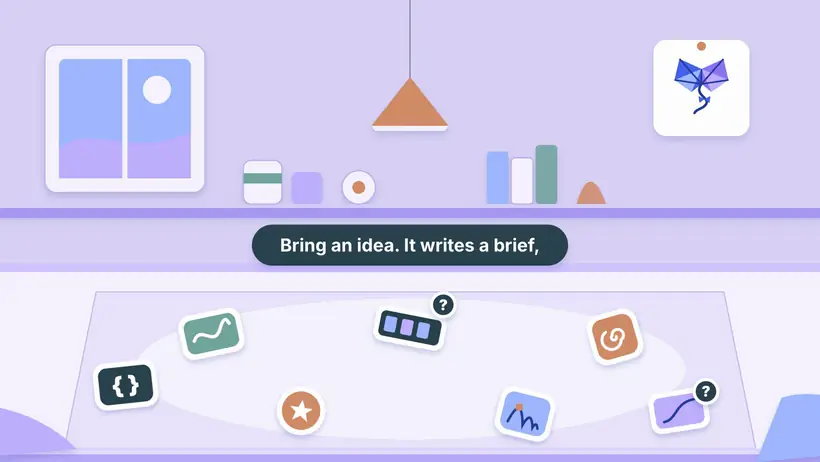
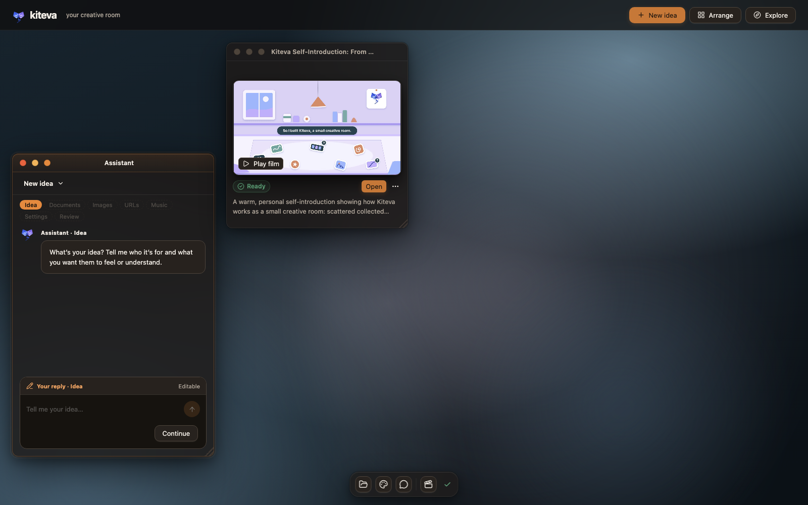
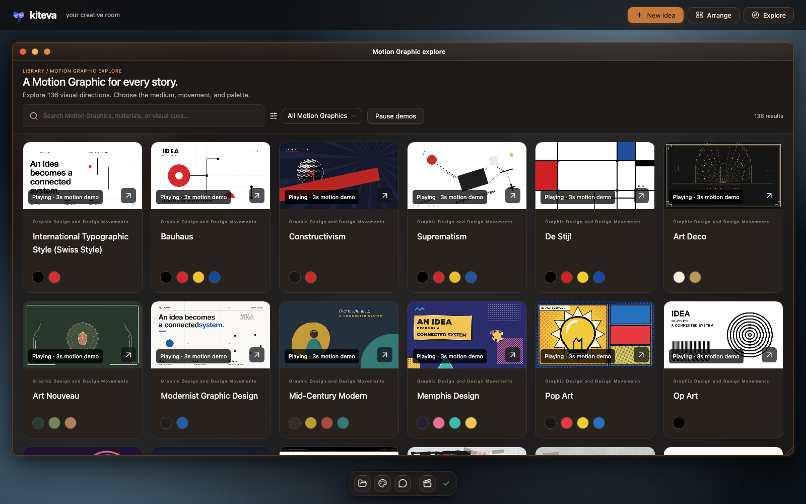
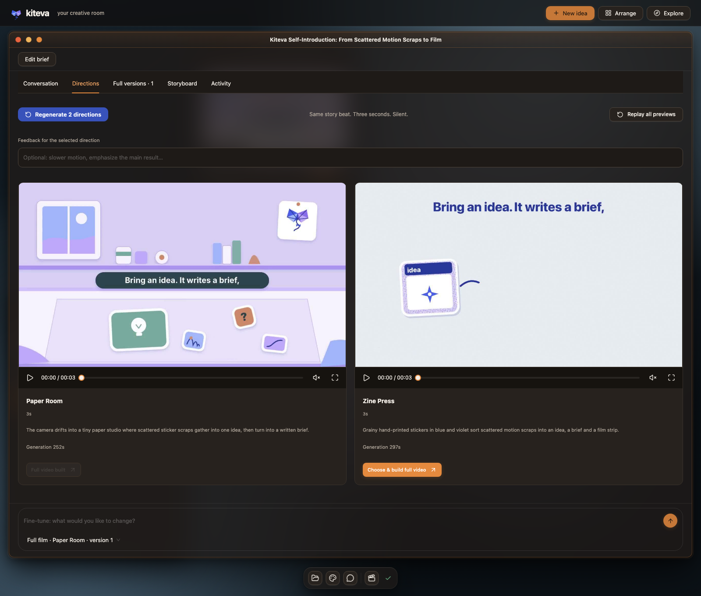
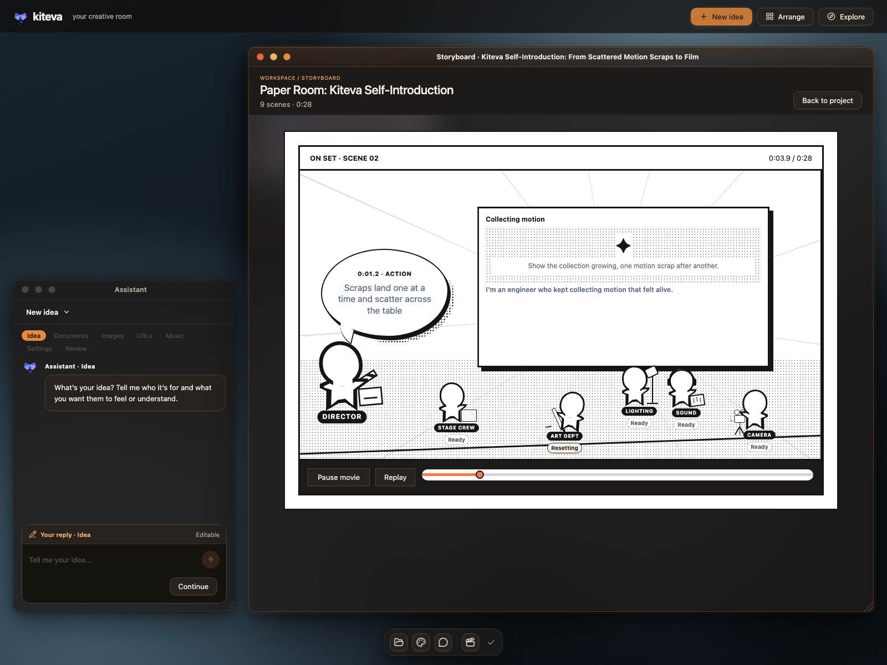

<p align="center">
  
</p>

<h1 align="center">kiteva</h1>

<p align="center">
  <b>A personal creative room where an idea turns into a short motion-graphics film.</b><br>
  Create with <a href="https://platform.claude.com/docs/en/about-claude/models/overview">Claude Opus 5.5</a> or <a href="https://developers.openai.com/api/docs/models/gpt-6.1-sol">GPT-6.1 Sol</a>.
</p>

<p align="center">
  <b>English</b> · <a href="README.zh-CN.md">简体中文</a>
</p>

<p align="center">
  <a href="docs/assets/kiteva-intro.mp4">
    
  </a>
  <br>
  <sub>This film was made in Kiteva, from one real run: 28 seconds with local Kokoro narration and a music bed the film agent wrote in code. Above is a silent 14-second loop from the middle; click it for the full MP4 with sound. <a href="docs/intro-video.md">How it was made</a>.</sub>
</p>

> [!IMPORTANT]
> **Non-commercial license.** Kiteva's source is shared under the [Kiteva Non-Commercial License](LICENSE).
> It's based on MIT but adds a no-commercial-use condition, so it's source-available and **not** an
> OSI-approved open source license. Third-party parts keep their own licenses. See [License](#license).

## Recent updates

Dates below use New Zealand time. Updates are released through the `main` branch.

<details>
<summary>2026-10-18</summary>

- **v0.1.0 — first source release.** See the [release notes](CHANGELOG.md#010--2026-10-18). Includes 138 Motion Graphics, 48 motions, both agent providers, headless website capture and English / Chinese delivery. Native Windows sandbox and render verification passed in CI; Windows support remains experimental.

- Added **English / 简体中文 video language**, translated narration and lyrics with preserved originals, and a separate Chinese Pocket TTS provider. Music and Narration / lyrics now have separate Assistant steps.
- Added **Cassette Futurism**: hardware panels, phosphor screens, tape reels and stepped animation, with a rendered preview. The collection now has **137 Motion Graphics**.
- Added **Terminal Lyric Duotone Anime**: flat blue, cream and black anime art in a CRT terminal frame, with bilingual decoding captions and ringed keyword titles, plus a code-drawn illustrative preview. Also added two motions, **Rotating Sonar-Sweep Reveal** and **Pixel-Tile Materialize & Targeted Delete**. The collection now has **138 Motion Graphics and 48 motions**.
- Added an **experimental native Windows backend**, platform-aware setup and a render verification command. Actual Windows 10/11 testing is still pending; project creation on Windows requires a successful verification first. See the [Windows setup guide](docs/windows.md).

- Published English and Chinese READMEs, a Kiteva-made introduction film, desktop and Storyboard screenshots, architecture diagrams, and technology and cost documentation.
- Added contribution guidance and the [non-commercial license](LICENSE).

</details>

<details>
<summary>2026-10-17</summary>

- Expanded the collection to **136 Motion Graphics and 46 motions**, refreshed animated previews and cached Motion Graphic summaries, and upgraded [Multiplane](https://github.com/LBEILC/Multiplane) to **0.3.10**.
- Made Activity labels specific to each task, separated preparation, review and repair, and indented updates under their task. Raw internal content stays hidden.
- Anatomy is now installed or updated at launch, with verified offline fallback; upstream skill files are no longer bundled.
- Added automatic narration loudness matching and a volume control, simplified Speech / vocals settings, and registered bundled skills through the Claude SDK.

</details>

## Why this exists

I'm not a professional designer. I'm a full-stack engineer working on content and creative tools,
and along the way I picked up a few creative ideas. Then I noticed [Opus 5.5](https://platform.claude.com/docs/en/about-claude/models/overview) has a real feel for this
kind of work. There's an internal hackathon coming up at my company, and I just find these motion
effects fun, so I started collecting motion pieces that had that certain something, along with notes
on what technology could make each one. The pile got big. So I built an agent to put that collection
and Opus 5.5 to work, to see how far it could go. The results surprised me, so I'm sharing the agent's
source here, under non-commercial terms.

I collected a lot. Some of it is dazzling, and some of it is probably wrong. I kept it all anyway 😄

Opus 5.5 is my favourite for the creative part. The [Codex](https://developers.openai.com/codex) provider with [GPT-6.1 Sol](https://developers.openai.com/api/docs/models/gpt-6.1-sol) is wired up too,
and I'm trying it out for fun. You choose the provider per project.

## What it does

**Idea → brief → Motion Graphic combinations → previews → full film → review and delivery**

<p align="center">
  
  <br><sub>The room right after the intro film finished. The Assistant starts a new idea; each project lives in its own widget.</sub>
</p>

- **A desktop-style room.** Everything happens in windows on a personal desktop: an assistant that
  walks you through the idea, documents, images, websites, music and lyrics, and settings, plus a material
  shelf and one widget per project. Nothing calls a model until you press **Create**.
- **A brief from your references.** A small model reads your files and, if you add websites, opens
  them in a fresh headless [Chromium](https://www.chromium.org) browser to take screenshots. It writes a structured brief and then checks it.
- **Motion Graphic combinations.** The main model reads summaries of all 138 Motion Graphics and
  proposes a dozen or more directions. Each pairs one primary Motion Graphic with supporting ones. A
  separate evaluator, [Typesafe](https://docs.typesafe.ai)'s [JEV](https://docs.typesafe.ai/models), scores them and keeps the number of directions you asked for (1–5).
- **Silent 3-second previews** of the same story beat, one per direction, so you can compare.
- **The full film** continues the preview session you picked, at 1080p or 1440p, 30 or 60 fps, up to
  5 minutes, with optional on-screen lyrics and local narration ([Kokoro](https://huggingface.co/hexgrad/Kokoro-82M) or
  [Pocket TTS](https://pypi.org/project/pocket-tts/)).
- **Review and delivery.** Every render is probed with `ffprobe` and fully decoded. With
  [HyperFrames](https://github.com/heygen-com/hyperframes), the default renderer, layout and contrast checks run
  too, and findings are repaired in focused rounds. The [Multiplane](https://github.com/LBEILC/Multiplane) trial
  skips those two checks and verifies frame consistency instead. A small model then reviews the result. You get
  an MP4, a poster, a project ZIP, a playback copy and a Storyboard.

<table>
  <tr>
    <td width="50%"></td>
    <td width="50%"></td>
  </tr>
  <tr>
    <td><sub>Explore all 136 Motion Graphics. Each card plays a reviewed 3-second demo.</sub></td>
    <td><sub>The two directions Kiteva previewed for the film above. I picked Paper Room.</sub></td>
  </tr>
</table>

### The Storyboard

<p align="center">
  
  <br><sub>The intro film's own Storyboard, caught during scene 2 of 9.</sub>
</p>

Every preview and film saves a `STORYBOARD.json` with timed scenes, beats, captions and audio notes
that match the actual composition. The Storyboard page plays it back as a little behind-the-scenes
rehearsal. A stick-figure director and crew (stagehand, lighting, lettering, sound, camera) walk to their
marks when a beat calls for their job, and you can play, replay or scrub through the film's timeline.

To be honest about what it is: the crew is a playful reading of the recorded cues, not real production
staff and not a live render monitor. Live progress is in each project's activity lines in the room.
And it has nothing to do with the UI-component tool called [Storybook](https://storybook.js.org).

## Numbers, counted from the source

|                                   |                                                                                                                                                                                      |
| --------------------------------- | ------------------------------------------------------------------------------------------------------------------------------------------------------------------------------------ |
| Motion Graphics                   | **136** (`assets/catalog/video-style-catalog.json`)                                                                                                                                  |
| Motions                           | **46** (`assets/catalog/motion-pattern-catalog.json`)                                                                                                                                |
| Technology pool entries           | **92** recommendations across visual construction, motion, rendering and supporting tools                                                                                            |
| Startup-installed authoring skill | **1** ([Anatomy](https://github.com/wheresryan22/anatomy))                                                                                                                           |
| Renderers                         | [HyperFrames](https://github.com/heygen-com/hyperframes) (default), [Multiplane](https://github.com/LBEILC/Multiplane) (trial), [Remotion](https://www.remotion.dev) (fallback only) |

Combinations are where it gets interesting. A direction can mix one primary Motion Graphic with
supporting ones (1–3 in total for films under 30 seconds, up to 6 for films over three minutes), and the
model picks motions and technologies to suit. That gives far more starting points than any single
style. It doesn't promise that every combination works. Some won't, which is why there are previews,
an evaluator and repairs.

## Who does what

| Job                                                                                      | Claude projects                                                                         | Codex projects                                                           |
| ---------------------------------------------------------------------------------------- | --------------------------------------------------------------------------------------- | ------------------------------------------------------------------------ |
| Brief, reference checks, Motion Graphic summaries, lyrics, result review, simple repairs | [Claude Haiku 5.5](https://platform.claude.com/docs/en/about-claude/models/overview)    | [GPT-6 Luna](https://developers.openai.com/api/docs/models/gpt-6-luna)   |
| Combination proposals, previews, the full film, pacing/style repairs                     | **[Claude Opus 5.5](https://platform.claude.com/docs/en/about-claude/models/overview)** | [GPT-6.1 Sol](https://developers.openai.com/api/docs/models/gpt-6.1-sol) |
| Scoring and choosing directions                                                          | [JEV](https://docs.typesafe.ai/models) via [Typesafe](https://docs.typesafe.ai)         | [JEV](https://docs.typesafe.ai/models)                                   |
| Recording every call, token count and cost estimate                                      | Governance report                                                                       | Governance report                                                        |

More detail, including the workflow diagrams, is in [docs/architecture.md](docs/architecture.md).

## Quick start

Native Windows 10/11 setup is experimental and has its own [installation and verification guide](docs/windows.md); WSL is not required.

For the tested macOS setup, you need [Node.js](https://nodejs.org) 24+, [Chrome](https://www.google.com/chrome/) or
[Chromium](https://www.chromium.org), and [FFmpeg](https://ffmpeg.org) with `ffprobe`. Then two kinds of access:

- **A model provider, by API key or by an existing signed-in subscription.** For Claude, set
  `ANTHROPIC_API_KEY` or `CLAUDE_CODE_OAUTH_TOKEN`, or just be signed in to
  [Claude Code](https://code.claude.com/docs/en/overview) on this Mac. For Codex, set `CODEX_API_KEY` or
  `OPENAI_API_KEY`, or be signed in to the [Codex CLI](https://developers.openai.com/codex) (`~/.codex/auth.json`).
  Subscriptions work, but I haven't tested how subscription usage or remaining percentage is reported.
- **[JEV](https://docs.typesafe.ai/models), configured separately.** Put `TYPESAFE_API_KEY` in `.env.local`.
  It's needed whenever Kiteva generates directions. Picking Motion Graphics yourself skips it.

```sh
git clone https://github.com/delexw/kiteva.git
cd kiteva
npm ci
cp .env.example .env.local      # add TYPESAFE_API_KEY (provider keys are optional if you're signed in)
npm run build
npm start                       # open http://127.0.0.1:4317
```

Optional: `npm run speech:setup` ([Kokoro](https://github.com/thewh1teagle/kokoro-onnx)) or `npm run speech:setup:pocket`
([Pocket TTS](https://pypi.org/project/pocket-tts/)) for local narration; add `npm run speech:setup:pocket:zh` for [Mandarin Pocket TTS](https://huggingface.co/hustfyb/PocketTTS-ZH-6L). See [language controls](docs/video-languages.md). They need [Python](https://www.python.org) 3.10–3.13. For UI development, keep the backend running and use `npx vite` ([Vite](https://vite.dev), `http://127.0.0.1:4319`).

Anatomy installs or updates automatically on server launch. Connect to the internet for the first launch; skill installation uses direct HTTPS ZIP downloads and needs no Git or extra CLI; later launches can use the last verified installation offline. Upstream files stay in Git-ignored `skills/anatomy/`, while provider registration and Kiteva guidance remain in source.

[React Bits](https://github.com/DavidHDev/react-bits) gives Claude and Codex component discovery during planning and source installation during building. See [integration and licensing](src/server/agents/capabilities/README.md).

[FluidSynth](https://www.fluidsynth.org/) renders agent-composed scores into local instrumental music for the existing narration mix, without another AI model. Install FluidSynth, then run `npm run music:setup`. See [setup and audio workflow](docs/instrumental-music.md).

The catalogs, reviewed artwork and 138 preview clips ship with the repo, so browsing costs nothing.
Your projects, uploads, room layout, databases and credentials stay in Git-ignored folders on your machine.

## What ships, and what you install

| Part                                                                                                                                                                                                                                                                          | What it is                                                                                           | Status                                                                                                                  |
| ----------------------------------------------------------------------------------------------------------------------------------------------------------------------------------------------------------------------------------------------------------------------------- | ---------------------------------------------------------------------------------------------------- | ----------------------------------------------------------------------------------------------------------------------- |
| [Anatomy](https://github.com/wheresryan22/anatomy)                                                                                                                                                                                                                            | Isometric technical-illustration skill and drawing kit (3D mode is beta)                             | Installed/updated from upstream at launch into Git-ignored `skills/anatomy/`; verified local fallback when offline; MIT |
| [HyperFrames](https://github.com/heygen-com/hyperframes) 0.8.144                                                                                                                                                                                                              | HTML video composition and export                                                                    | npm dependency, pinned, default renderer                                                                                |
| [Multiplane](https://github.com/LBEILC/Multiplane) 0.3.10                                                                                                                                                                                                                     | `render(t)` shot renderer with motion blur                                                           | npm dependency, pinned, trial setting                                                                                   |
| [Remotion](https://www.remotion.dev) 4.x                                                                                                                                                                                                                                      | React video renderer                                                                                 | npm dependency, fallback only (has its own license terms)                                                               |
| `reference_browser` / `capture_video`                                                                                                                                                                                                                                         | Headless website inspection, screenshots and walkthrough recording via [Puppeteer](https://pptr.dev) | Built into Kiteva, for both providers                                                                                   |
| [Kokoro](https://github.com/thewh1teagle/kokoro-onnx), [Pocket TTS](https://pypi.org/project/pocket-tts/)                                                                                                                                                                     | Local narration                                                                                      | Python set up by `npm run speech:setup*`. Weights downloaded to Git-ignored `models/`                                   |
| [Claude Agent SDK](https://github.com/anthropics/claude-agent-sdk-typescript), [Codex SDK](https://github.com/openai/codex/tree/main/sdk/typescript), [`@typesafe-ai/sdk`](https://docs.typesafe.ai/sdk/javascript)                                                           | Model providers and JEV                                                                              | npm dependencies                                                                                                        |
| [Caveman](https://github.com/JuliusBrussee/caveman)                                                                                                                                                                                                                           | Local token-compression proxy for SDK calls                                                          | npm dependency, on by default                                                                                           |
| [GSAP](https://gsap.com), [Three.js](https://threejs.org), [PixiJS](https://pixijs.com), [Paper.js](http://paperjs.org), [Rough.js](https://roughjs.com), [Motion](https://motion.dev), [chroma.js](https://gka.github.io/chroma.js/), [Pica](https://github.com/nodeca/pica) | Drawing and motion libraries offered to generated films                                              | npm dependencies                                                                                                        |
| [React](https://react.dev), [Ant Design](https://ant.design) + [Ant Design X](https://x.ant.design), [Radix](https://radix-ui.com), [Tailwind CSS](https://tailwindcss.com), [Vite](https://vite.dev), [Fastify](https://fastify.dev), [Zod](https://zod.dev)                 | App UI, server and shared contracts                                                                  | npm dependencies                                                                                                        |
| [FFmpeg](https://ffmpeg.org), [Chrome](https://www.google.com/chrome/)/[Chromium](https://www.chromium.org), [Python](https://www.python.org), [Blender](https://www.blender.org) (optional)                                                                                  | External tools                                                                                       | Not bundled. You install them                                                                                           |

Being in the 92-entry technology pool doesn't mean a library is installed. Twelve pool entries are
recommendations only, and generation can't install packages or use the network. The full list with a
status for every entry, plus all 77 direct npm dependencies, is in [docs/technology-pool.md](docs/technology-pool.md).

## What it costs

From Kiteva's own governance report (snapshot 2026-10-17, app pricing date 2026-10-13), my three
earlier development projects (all Claude, 90–120 s films, five preview directions each) came to
**$16.46, $18.73 and $37.42** in SDK-estimated, API-equivalent model usage. More than 90 % of input
tokens were cache reads. Nearly all of the cost is Opus writing previews and the film. Haiku's
preparation and review work cost cents, and JEV ranking under a cent. The expensive one regenerated
its directions and needed nine repair calls.

That's three projects, not a benchmark or a per-minute price. Local compute (render time, electricity)
isn't priced, and there's no GPT-6.1 Sol example yet. These are token counts priced at API rates. If
you're signed in with a subscription instead of an API key, they are **not** your bill and not a meter of
your plan's allowance. I haven't tested subscription usage or remaining-percentage reporting. Method and caveats:
[docs/costs.md](docs/costs.md).

## Known limits

- macOS is the tested platform. Native Windows 10/11 support is experimental; see [Windows setup and required checks](docs/windows.md). Single user, local only.
- [Multiplane](https://github.com/LBEILC/Multiplane) is a trial: one sound file, no video clips inside scenes, and no automatic layout or contrast checks (frame consistency is still verified).
- [Remotion](https://www.remotion.dev) is a fallback, not a setting, and its renders skip the HyperFrames layout/contrast checks too.
- No generated singing, image generation or stock footage. Visuals are drawn in code, or come from your uploads and website captures.
- The catalog is my personal collection. Some descriptions or technology suggestions may be off. Issues are welcome.
- Generation takes a while, often many minutes per preview, and uses real API credit or subscription usage.

## Docs

- [Architecture](docs/architecture.md): components, workflow, renderers, capture, skills, storage (Mermaid diagrams)
- [Technology inventory](docs/technology-pool.md): all 92 pool entries, the startup-installed skill, renderers, TTS and every dependency
- [Costs](docs/costs.md): how the governance numbers are computed
- [Intro film provenance](docs/intro-video.md): how the film above was made in Kiteva
- [README references](docs/readme-references.md): open projects whose READMEs I learned from
- [Application guide](docs/application-guide.md) · [Speech setup](docs/speech.md) · [Multiplane trial](docs/multiplane-trial.md)

## Contributing

Bug reports, catalog corrections and focused PRs are welcome. See [CONTRIBUTING.md](CONTRIBUTING.md)
for setup, the checks to run (`npm run lint`, `npm test`, `npm run build`), the creative quality bar
(seekable compositions, real rendered frames) and third-party rules.

## License

Kiteva's own code, catalogs and docs are © 2026 Yang Liu ([@delexw](https://github.com/delexw)),
licensed under the [Kiteva Non-Commercial License](LICENSE). In short: you may use, copy, modify and
share it for non-commercial purposes, such as personal projects, learning, research and evaluation,
with the notice kept. Internal, non-production evaluation inside an organisation, like trying it at an
internal hackathon, counts as non-commercial. Selling it, offering it as a paid service, using it for paid
client work, or putting what you make with it into commercial production needs separate permission. Ask in an issue. This summary isn't legal advice, and the
LICENSE text is what applies.

Bundled and dependent software keeps its own license: [Anatomy](https://github.com/wheresryan22/anatomy) (MIT), [HyperFrames](https://github.com/heygen-com/hyperframes) and [Multiplane](https://github.com/LBEILC/Multiplane)
(Apache-2.0), [Remotion](https://www.remotion.dev/license) (Remotion License), [GSAP](https://gsap.com/standard-license)
(GSAP Standard License) and the rest as listed in [docs/technology-pool.md](docs/technology-pool.md).
Model providers, speech models and other services have their own terms.
