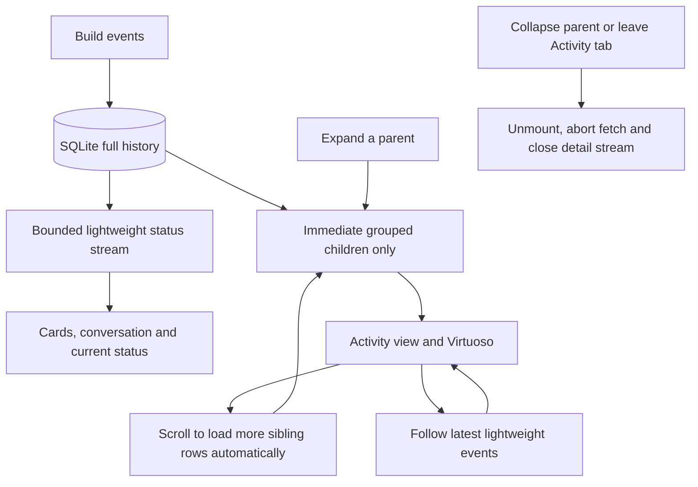

# Activity history and frontend memory

SQLite remains the full event-history owner. Prompts, usage payloads, tool-output bodies and internal model text are retained for diagnostics and Governance; they are not sent to the project Activity UI.

`GET /api/runs/:id/activity/children` accepts a version `jobId` (empty for preparation), a dot-separated parent `path`, and a sibling `offset`. It returns at most 100 immediate child rows with `hasChildren`, rather than recursively including descendants. Expanding any parent, at any depth, uses the same `ActivityBranchView`. Closing it unmounts all descendants, aborts requests and disconnects live following. There are no Older/Newer/Latest buttons; scrolling near a branch's end automatically requests the next sibling slice.

The existing event interpretation and deduplication functions now live in shared modules. Both the UI and the server use those functions, so on-demand history preserves grouping rather than inventing a second hierarchy. SQLite keeps the complete raw history. The backend projects diagnostic rows before building a tree, caches at most four grouped version trees, and invalidates a tree when new events arrive. Deletion and shutdown clear retained cache entries. The older cursor-based `/activity` API remains compatible with existing consumers.

Parent headers are lightweight summaries. Child requests begin only after expansion. The root of an active version follows its live event stream and shares refresh notifications with its expanded descendants; historical versions do not open unnecessary live connections. Reopening a group fetches its current children. Retry actions retain their originating job ID.

The project status subscription uses `view=summary`; it starts with a recent window instead of replaying every stored event. The frontend retains at most 256 ordinary summary events, plus bounded scope metadata and one latest phase per job. Activity branches retain loaded sibling rows only while expanded; lists exceeding 100 rows use Virtuoso. Separate limits of 128 scope records and 64 phase boundaries preserve group ownership and renderer progress without allowing metadata to grow indefinitely. Subscription deduplication and pending queues are bounded as well.

Activity responses include the scope ancestors and preceding phase needed to interpret that page. Raw prompts and result bodies stay in SQLite. Existing raw diagnostic consumers retain their transport; the project frontend explicitly opts into lightweight transports.

Code owners:

- `src/shared/project-activity.ts`: safe UI event projection and bounded windows.
- `src/shared/activity-model.ts` and `activity-display.ts`: shared event interpretation and grouping.
- `src/shared/activity-branches.ts`: immediate-child slices at any tree depth.
- `src/server/jobs/store.ts`: cursor queries and operation context.
- `src/server/app.ts`: history-page API and lightweight SSE views.
- `src/client/lib/project-event-stream.ts`: stream batching, deduplication and disposal.
- `src/client/room/project-activity-panel.tsx`: lightweight parent headers.
- `src/client/room/activity-branch.tsx`: one recursive loader, automatic sibling loading and disposal.

Tests use local fixtures and mocked browser transports, with no external provider APIs or credentials. Coverage includes transport size, preservation of stored diagnostics, page boundaries, metadata, bounded live windows, retry targets, reopening and stream cleanup.

A completed, failed, cancelled or interrupted job cannot keep unresolved entries spinning while other jobs in the project continue. The shared interpreter reconciles each row against its own job phase. Unfinished entries become **Stopped**, preserving recorded successes and failures; finishing a later attempt does not invent a successful outcome for an earlier unfinished tool. Customer text streams also stop animating when their job is terminal. The branch cache includes that job phase in its validity check.
