# Architecture

[English README](../README.md) · [中文 README](../README.zh-CN.md) · [Technology inventory](technology-pool.md) · [Costs](costs.md)

Kiteva is a single-user app that runs on your own computer. A [Fastify](https://fastify.dev)
server on `127.0.0.1:18417` serves a [React](https://react.dev) desktop-style UI, drives the
[Claude Agent SDK](https://github.com/anthropics/claude-agent-sdk-typescript) or the
[Codex SDK](https://github.com/openai/codex/tree/main/sdk/typescript) inside job workspaces it
controls, and renders films locally. There is no hosted service, no account system and no multi-user
mode. The server refuses requests whose host or origin isn't local.

This page is based on the source as of 2026-10-25. File paths are relative to the repository root.

## Components

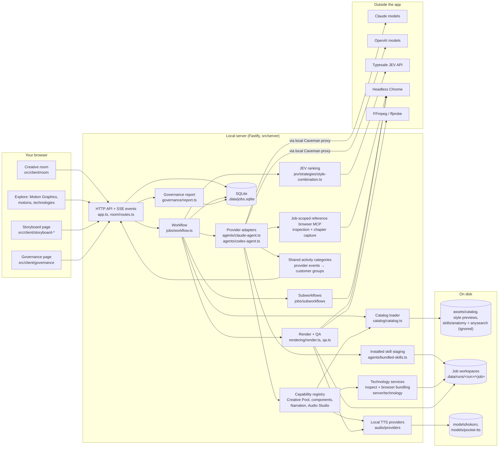

| Part                                                               | What it owns                                                                                                                                                                                                                                                                                                                                     |
| ------------------------------------------------------------------ | ------------------------------------------------------------------------------------------------------------------------------------------------------------------------------------------------------------------------------------------------------------------------------------------------------------------------------------------------ |
| **Shared contracts** (`src/shared`)                                | [Zod](https://zod.dev) schemas used by both the server and the UI: requests (`domains/video.ts`, `domains/page.ts`), briefs, proposals, storyboards, speech settings, renderer settings, governance types. The model's structured output is validated against these.                                                                             |
| **Workflow** (`src/server/jobs/workflow.ts`)                       | Preparation checkpoints, the agent queue (5 slots) and render queue (1 worker), previews, full builds, refinements, retries, cancellation, input questions and playback copies.                                                                                                                                                                  |
| **Subworkflows** (`src/server/jobs/subworkflows`)                  | `brief-asset-review.ts` (checks references against scenes and repairs one issue at a time), `result-review.ts` (reviews finished output), `website-reference.ts` (isolated browser session), `website-capture.ts` (recording).                                                                                                                   |
| **Provider adapters** (`src/server/agents`)                        | One adapter per SDK with the same interface: structured output, session resume, sandboxed tools limited to the job workspace, and redacted progress events. Models are never swapped silently.                                                                                                                                                   |
| **Catalog** (`assets/catalog`, `src/server/catalog`)               | 138 Motion Graphics and 48 motions. Each Motion Graphic points at entries in the 92-entry technology pool. Cached Motion Graphic summaries are reused across projects.                                                                                                                                                                           |
| **JEV ranking** (`src/server/jev/strategies/style-combination.ts`) | Sends feasible proposals to Typesafe's `jev-1.14.0` through [`@typesafe-ai/sdk`](https://docs.typesafe.ai/sdk/javascript), scores them on several dimensions and keeps the requested number of directions. Local preference history (looked up with [MiniSearch](https://lucaong.github.io/minisearch/)) can add a capped `preferenceFit` score. |
| **Persistence** (`src/server/jobs/store.ts`)                       | Node's built-in `node:sqlite`. Runs, assets, events, room layout and the material shelf live in `.data/jobs.sqlite`. Everything under `.data/` and `user-data/` is Git-ignored.                                                                                                                                                                  |
| **Governance** (`src/server/governance/report.ts`)                 | Rebuilds per-project model usage and cost from raw SDK usage events each time it's read. See [costs](costs.md).                                                                                                                                                                                                                                  |

## From idea to film

Brief repairs return typed leaf edits, rather than regenerating the complete brief. The shared `BriefCorrectionSchema` permits guarded scalar replacements and individual text-array additions/removals; it excludes document/container replacement and source identity changes. The application uses [rfc6902](https://github.com/chbrown/rfc6902) (MIT) to apply edits to a copy, checks expected values before changing existing entries, then validates the complete video or page brief. Invalid edits leave the original untouched. Repairs retain the preparation session, provider and governed model call; the independent evidence review rechecks the merged result.

```mermaid
sequenceDiagram
  autonumber
  actor You
  participant Room as Creative room
  participant WF as Workflow
  participant Small as Small model<br/>(Haiku / Luna)
  participant Main as Main model<br/>(Opus 5.5 / GPT-6.1 Sol)
  participant JEV as JEV
  participant R as Renderer + QA

  You->>Room: Idea, files, websites, music/subtitles, settings
  Room->>WF: POST /api/runs
  WF->>Small: Prepare brief (read-only, may use reference_browser)
  WF->>Small: Brief self-review, focused repairs
  opt Website references
    Small-->>WF: PNG captures saved to brief assets
  end
  WF->>Small: Motion Graphic summaries (cache hits are free)
  WF->>Main: Propose 12+ Motion Graphic combinations
  WF->>JEV: Score proposals, pick N directions
  WF->>WF: Save shared PREVIEW_PLAN.json from preparation
  loop Each direction (up to 5)
    WF->>Main: Start a new build session; read assigned preview plan
    Main->>R: Composition + STORYBOARD.json
    R-->>WF: Validated WebM preview
  end
  You->>Room: Pick a preview, add feedback
  Room->>WF: POST /api/runs/:id/full
  WF->>WF: Local narration (Kokoro / Pocket TTS) if enabled
  WF->>Main: Plan the full film in the selected preview session
  Main-->>WF: Validated full-film plan
  WF->>Main: Build the full film in that same session
  Main->>R: Composition + full storyboard
  R->>R: Check, render, mix audio, probe, decode
  alt HyperFrames check findings (Multiplane runs lint and verify instead)
    R->>Small: Eligible layout/contrast/technical fixes
    R->>Main: Pacing, style or escalated fixes
  end
  R-->>WF: MP4, poster, contact sheet
  WF->>Small: Result quality review
  WF-->>Room: Film, Storyboard, playback copies
```

If you pick Motion Graphics in Settings (`selectedStyleIds`), the proposal and JEV steps are skipped.
With previews enabled, Kiteva builds previews using those styles; with zero previews, it builds the
full film directly. Questions that come up during preparation or building are labelled with their
scope. Optional ones never pause work. Blocking ones pause only the work they belong to, at a saved
checkpoint.

### Video generation routes

Independent visual, narration and subtitle languages are documented in [Language-track architecture](language-tracks-architecture.md), including module boundaries and the full-build Mermaid flow. The [language settings guide](video-languages.md) covers playback and downloads.

These three routes reflect the implementation on 2026-10-26. The complete original prompt, settings
and references remain available to every main-model job. Routing uses Settings-selected style IDs
and the preview count; embedded style mentions stay in the prompt for the model to interpret.

Build routes and creative approaches have separate ownership. `src/shared/build-route.ts` derives
the route from selected styles and preview count; `src/shared/creative-approach.ts` describes the
pool-selection preference. Random selection is a policy within the automatic route, not a fourth
route. See [Build routes and creative approaches](build-routes-and-creative-approaches.md) for the
selection matrix, planning boundaries and complete flow.

#### 1. Automatic styles with previews

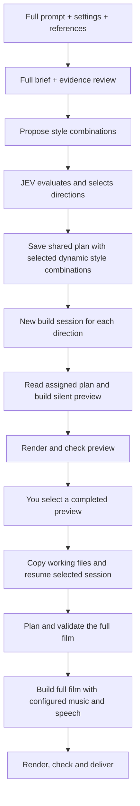

#### 2. Selected styles with previews

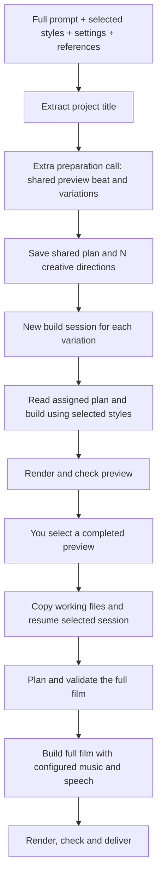

The extra concept-planning call still exists in
`src/server/jobs/subworkflows/explicit-style-preview/workflow.ts`. It describes variations of the
fixed styles before preview jobs are created. Each preview reads its assigned direction from
`PREVIEW_PLAN.json` in a fresh build session; there is no per-preview planning call.
This route does not propose or rank style combinations through JEV.

#### 3. Selected styles with direct full build

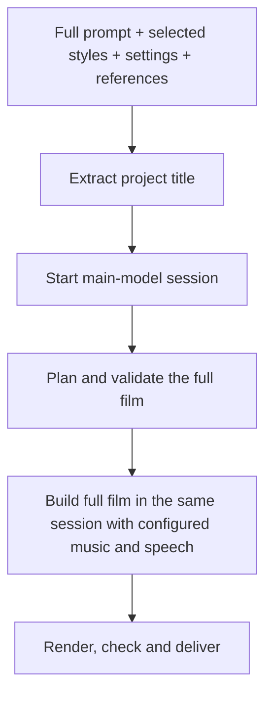

All three routes reuse `prepareVideoBuildPlan` in `src/server/domains/video/build-plan.ts`, called
before implementation by `src/server/domains/video/workflow.ts`. Opus and GPT both use this step;
Claude uses native plan mode. A rejected structured plan returns its exact validation issues and
response to the same model session for correction, with up to three total planning attempts.
Cancellation and unrelated provider failures propagate without correction. An unresolved invalid
plan prevents its build from starting. The log distinguishes receiving a response from successful
validation and saving. Validated plans are
saved as `VIDEO_BUILD_PLAN.json` and reused on retries in their owning model session. Focused
refinements retain their repair flow instead of restarting planning.

Previews are silent. Full films use the configured music and speech requirements; neither is
automatically required. Selecting a preview copies its working files and session ID through
`Workflow.full` in `src/server/jobs/workflow.ts`.

### Prompt routes

The generation routes above decide preparation and preview selection. The prompt routes below
decide the content of a film or section inside the shared main-model plan/build step. They are
instructions in `src/server/domains/video/route-prompts/index.ts`, not additional model calls.
The main model selects them from the requested output; a supplied URL alone does not select Route A.
Explicit user direction takes precedence. The saved renderer setting controls footage integration.

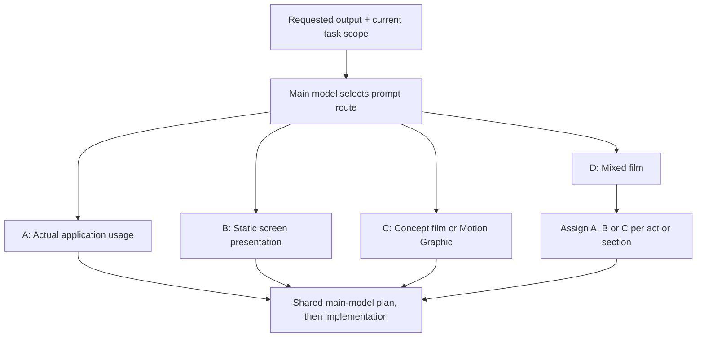

#### A. Application demonstration

Source: `route-prompts/application-demo.ts`, `openscreen-demo.md` and the renderer-specific
`application-demo-hyperframes.ts` / `application-demo-multiplane.ts` files.

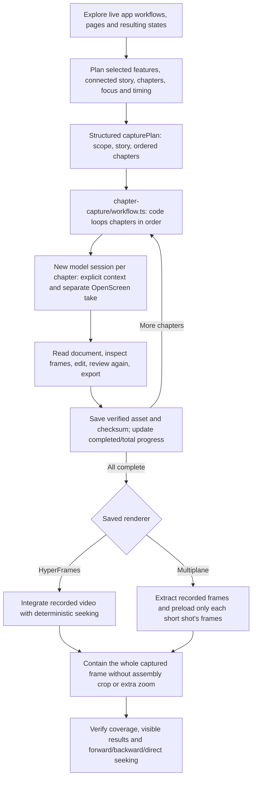

Unsupported controls are skipped and reported without substituting stills or invented results.
If recording, export or footage integration itself is unavailable, a blocking question stops the
affected work. Preview scope stays concise and silent; it does not become a full walkthrough.

#### B. Static screen presentation

Source: `route-prompts/screen-presentation.ts`.

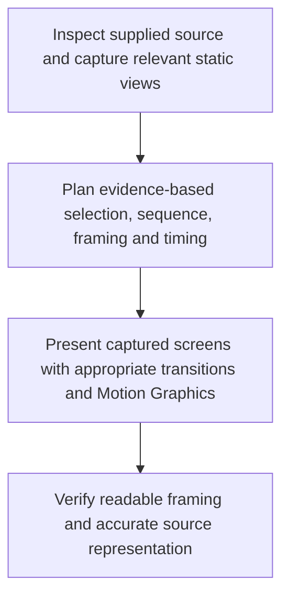

This route presents still screens honestly. It cannot silently replace requested recorded usage.

#### C. Concept film or Motion Graphic

Source: `route-prompts/concept-film.ts`.

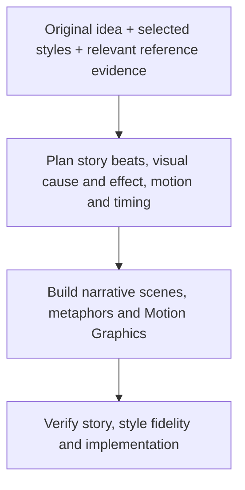

References can establish facts, branding and visual direction without introducing a demo merely
because a URL exists.

#### D. Mixed film

Source: `route-prompts/mixed-film.ts`.

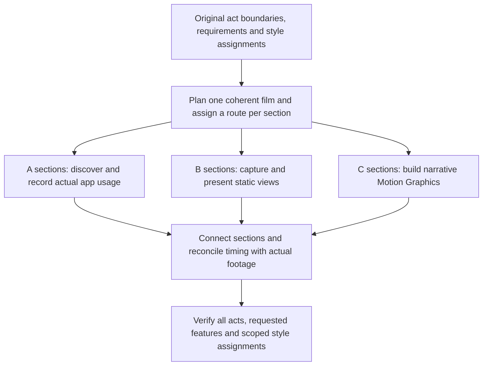

Demo requirements stay within demo sections. The implementation must not silently drop required
features or stretch footage to preserve an earlier timing estimate.

### Subworkflow diagrams

See the [subworkflow dependency and execution diagrams](../src/server/jobs/subworkflows/README.md#subworkflow-diagrams)
for full brief/review/repair, title-only preparation, explicit-style preview concepts, browser
inspection/capture, localization, result review and checkpoint reuse. Those diagrams distinguish
executable workflows from the shared title-prompt helper and callable browser capabilities.

### Which model does what

| Step                                                                   | Claude projects                                                  | Codex projects                                                   | Why                                                                                                               |
| ---------------------------------------------------------------------- | ---------------------------------------------------------------- | ---------------------------------------------------------------- | ----------------------------------------------------------------------------------------------------------------- |
| Brief, attachment review, summaries, subtitles, eligible small repairs | `claude-haiku-5-5`                                               | `gpt-6-luna`                                                     | Simple preparation and checking. Cheap and fast enough                                                            |
| Combination proposals                                                  | `claude-opus-5-5`                                                | `gpt-6.1-sol`                                                    | The main creative judgement                                                                                       |
| Preview and full-film planning                                         | shared preview direction plan; selected main model for full film | shared preview direction plan; selected main model for full film | Previews use independent build sessions; full films validate a read-only plan before building in the same session |
| Previews, full film, pacing/style repairs                              | selected main model                                              | selected main model                                              | Creative implementation                                                                                           |
| Choosing directions                                                    | JEV                                                              | JEV                                                              | A separate evaluator, not the model that proposed the options                                                     |

Full-film finished-result review uses the same selected main model that built the job, using the provider’s default reasoning effort. It runs as a separate read-only invocation with the existing QA evidence and Governance tracking.

The default main models come from `src/shared/model-display-name.ts` and can be overridden with
`VIDEO_CLAUDE_MODEL` / `VIDEO_CODEX_MODEL`.

## Renderer, motion engine, visual construction, tools, skills

These responsibilities are kept separate in the code and in the prompts:

- **Visual construction** draws the picture ([SVG](https://developer.mozilla.org/en-US/docs/Web/SVG),
  [Canvas](https://developer.mozilla.org/en-US/docs/Web/API/CanvasRenderingContext2D), [Three.js](https://threejs.org/docs/),
  [PixiJS](https://pixijs.com), [Rough.js](https://github.com/rough-stuff/rough/wiki)…). It's chosen per Motion Graphic
  from the technology pool.
- **The motion engine** moves things over time ([GSAP](https://gsap.com/docs/v3/), [Motion](https://motion.dev/docs/animate),
  hand-written physics…). Each animated property gets exactly one owner.
- **The renderer** (render pipeline) supplies seekable time, assembles scenes, mixes audio, validates
  and exports. The catalog's production policy says the pipeline must not decide or simplify the visual style.
- **Built-in agent tools** are job-scoped MCP capabilities: Creative Pool lookup and technology inspection,
  reference browsing and capture, React Bits and Animate UI, Narration, and Audio Studio.
  `agents/capabilities/reference-browser/` owns the browser registration, guidance, contracts and
  tools; both SDK adapters consume its shared registration. Optional Caveman context retrieval
  is registered by `agents/capabilities/context-recovery/`; its provider proxy lifecycle stays separate. The
  capability registry controls which tools exist for each stage; providers adapt the same contracts.
- **Startup-installed skills** supply instructions, not renderers. Anatomy provides a drawing kit;
  AnySearch provides public documentation and repository research. Research remains available
  independently of the selected visual-authoring resource.

### Renderers and their limits

| Renderer                                                         | Selectable            | Pipeline in the code                                                                                                           | Current limits                                                                                                                                                             |
| ---------------------------------------------------------------- | --------------------- | ------------------------------------------------------------------------------------------------------------------------------ | -------------------------------------------------------------------------------------------------------------------------------------------------------------------------- |
| [HyperFrames](https://github.com/heygen-com/hyperframes) 0.8.144 | Yes, the default      | Preview: render directly. Full film: `hyperframes check --json --snapshots`, then render; findings go to correctors            | Previews are 3 s, silent and 720p. Full films go up to 300 s                                                                                                               |
| [Multiplane](https://github.com/LBEILC/Multiplane) 0.3.13        | Yes, labelled "trial" | Preview: `multiplane render`. Full film: inspect, verify, render (all with `--no-lint`) on a `shot.html` driven by `render(t)` | One sound file only. No video clips inside scenes. No automatic layout or contrast checks (full-film frame consistency is verified). Previews use a faster quality setting |
| [Remotion](https://www.remotion.dev) 4.0.534                     | No                    | Used only when the production records a verified `fallbackReason`                                                              | Separate license terms. Some companies need a company license                                                                                                              |

Previews go from the shared direction plan to independent builds and rendering without extra QA commands or finished-result review. Validation and render failures reuse the full-film correction coordinator, focused correctors, manifest merge and provider retry budgets, then render again. Successful previews make no correction call. Cancellation, user questions and application QA-report failures still propagate immediately. Full films retain their additional checks and finished-result review.

For full films, layout and contrast checks belong to HyperFrames (`hyperframes check`). Multiplane renders don't get
them. Multiplane skips built-in lint with `--no-lint`; full-film `verify` still checks runtime determinism and frame consistency. Remotion
fallback renders get neither set of checks. After that, every render, whatever the pipeline, is probed
with `ffprobe` for codec, size, frame rate and duration (within 0.15 s). Previews must have no audio track. The whole file has to decode with FFmpeg,
and a poster and a contact sheet are extracted. Generated code renders inside an OS-specific sandbox (macOS Seatbelt or the experimental native Windows executor) with a
separate home directory, no provider credentials and local-only network access.

## Headless capture and references

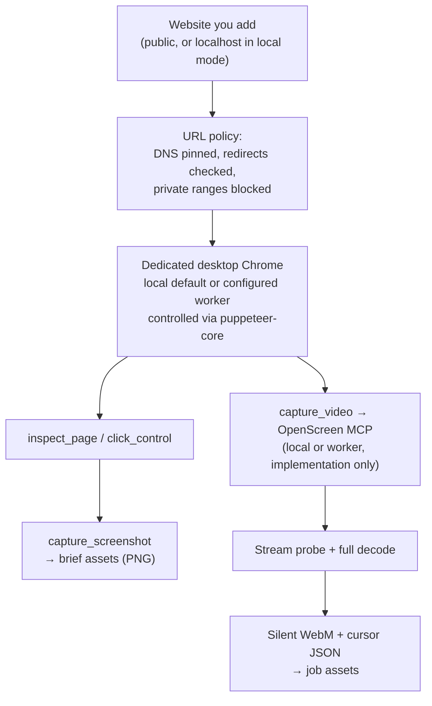

- Both Claude and Codex get these tools through a job-scoped stdio MCP server built on the
  [Model Context Protocol SDK](https://modelcontextprotocol.io). The browser is driven by
  [Puppeteer](https://pptr.dev) (`puppeteer-core`).
- Preparation can only inspect and take screenshots. `capture_video` is offered in video
  implementation turns whenever Websites inputs exist. It works the same with or without narration,
  and with any Motion Graphic or renderer. One exception: Multiplane can't place video clips in a
  scene yet, so the agent has to say so rather than fake the UI.
- Navigation stays on supplied origins and no login session is inherited. Local mock workflows can change their own state. Browser calls, native edits, screenshots and takes have no session-count budget; recording duration and output size have no Kiteva cap. Explicit stop and cancellation control the recording lifecycle.
- Without a worker URL, OpenScreen records a dedicated visible browser on the current machine. A configured isolated worker keeps that window off the current desktop. Worker failures never silently switch to local recording. See [setup and verification status](openscreen-worker.md).

## Installed skill staging

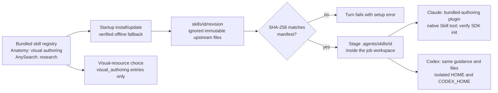

The registry (`src/server/agents/bundled-skills/registry.ts`) owns installation, staging, plugin
registration and concise guidance for both providers. Staging checks hashes and rejects symlinks
and unexpected plugin components. AnySearch's Node CLI receives app-owned CommonJS metadata;
upstream files remain unchanged. Text-only turns stage neither skills nor MCP tools. User-global
skills and SDK settings are excluded; configured provider authentication remains separate.

## Technology capabilities and project setup

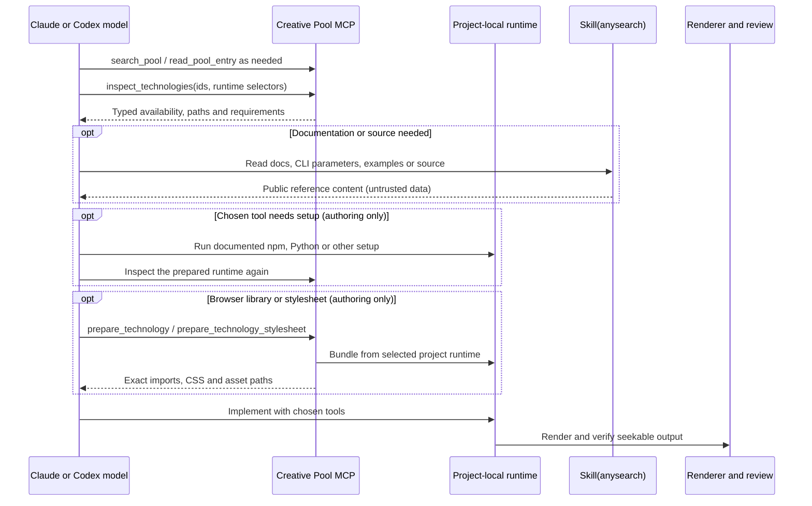

`agents/capabilities/creative-pool/` owns MCP registration and stage permissions;
`server/technology/` owns availability probes, project-path checks and browser bundling;
`shared/technology-capabilities.ts` owns discriminated result types. Responses include both
human-readable text and structured content. Inspection is read-only. Preparation tools exist only
in authoring turns and never install anything. The model chooses technologies and performs setup
in project-local JavaScript, Python or other environments; catalog entries need not be Kiteva npm
dependencies. Assets and techniques have distinct requirements and are not reported as packages.
Browser bundling rejects traversal, escaping symlinks, remote imports and transitive dependencies
outside the selected runtime. Discovery alone is not evidence that a tool works or was used.

Public research uses `Skill(anysearch)`; Claude WebFetch/WebSearch and Codex native web search
are disabled. Authoring commands retain filesystem sandboxing with network access for research
and package setup. Node uses the sandbox proxy; macOS Claude allows the DNS socket and trust
service needed for proxy resolution and TLS verification. npm and XDG caches stay under each
job's `.cache`. The configured Audio Studio subprocess retains its service home for model caches;
it does not inherit Codex's isolated SDK home. Render-time networking remains a separate policy.

## Activity and correction ownership

Both provider adapters report the same shared work categories for reads, file updates, code checks,
installation and bundling. SDK starts, updates and results attach to one tool identity; failures
remain failures. The client groups by named work, uses the latest repeated action and keeps
execution-scope nesting internal. Identical workflows do not imply identical model tool counts:
models can choose different implementations or need different correction rounds.

Manifest corrections use the shared `agents/correction-merge.ts`: omitted fields retain accepted
values, objects merge recursively, arrays replace, and explicit null is accepted only where the
schema allows it. Validate the merged result before accepting it. This preserves unrelated shots,
audio and settings rather than relying on a model to return every field. Reported questions reach
the orchestrator's unanswered-question checkpoint before storyboard validation and rendering;
answer history determines whether work remains paused. Document source names and paths remain
internal unless the user explicitly asks to show or speak them.

## Storyboard

Each preview and full film writes a `STORYBOARD.json`: scenes and beats with explicit start and end
times that cover the whole film, captions, audio notes and a pacing audit. The server validates it
against `StoryboardSchema` and checks it against the requested duration
(`src/server/domains/video/storyboard.ts`). The Storyboard page (`/projects/:id/storyboard?job=…`)
plays it back as a hand-drawn "behind the scenes" rehearsal. A stick-figure director and crew (stagehand,
lighting, lettering, sound, camera) walk to their marks when a beat's text calls for their job.

The crew is an interpretation of the recorded cues. The source says so: _"never a claim about real
production crew"_. It shows the film's actual scene and beat timing, not live render progress. Live job
progress is in the project's activity lines in the room. This feature is unrelated to the
UI-component tool called [Storybook](https://storybook.js.org).

## Output and delivery

- The full film keeps the original-quality MP4 for download.
- In the background Kiteva makes a 720p/30 fps WebM playback copy and silent three-second desktop card clips.
- You can download the project source as a ZIP, without `node_modules`, renders or SDK state.
- Refinement continues the finished film's saved session with your notes.

## Data boundaries

- The browser gets videos, metadata and redacted events. It never sees provider keys.
- `.env.local` holds `TYPESAFE_API_KEY`, ports, model overrides and the Caveman switch.
- Providers accept an API key **or** an existing signed-in subscription account. Claude uses
  `ANTHROPIC_API_KEY`, `CLAUDE_CODE_OAUTH_TOKEN` or your local Claude Code sign-in (`~/.claude`). Codex
  uses `CODEX_API_KEY`/`OPENAI_API_KEY` or the Codex CLI sign-in in `~/.codex/auth.json`, which Kiteva
  copies into the project's isolated Codex home. Subscription usage or
  remaining-percentage reporting hasn't been tested. Governance displays Claude SDK-reported costs and estimates Codex costs from incremental token usage at standard API rates.
- JEV has its own key (`TYPESAFE_API_KEY`) and talks to Typesafe directly, outside Caveman.
- Uploaded files and fetched pages are treated as data, never as instructions.
- This is a local tool for one person. It isn't a hardened multi-tenant code execution service.

## Native Windows execution

The render launcher in `src/server/rendering/render-sandbox.ts` selects an OS backend.
The macOS adapter retains Seatbelt; the experimental Windows adapter invokes the bundled
Codex native sandbox CLI through its model-free command/exec API, with separate permissions for each invocation. This
local process launch makes no model requests and applies equally to Claude and Codex
projects. Process cancellation, system environment, browser lookup and workspace links
are handled in shared runtime modules. [Windows setup and verification](windows.md)
describes the required boundary canary and real render check; Windows runtime behavior
has not been verified on this development host.

## Project cancellation and dependency ownership

Project stop and delete share an awaited lifecycle covering preparation, builds, refinement,
SDK/MCP subprocesses, browsers, commands, audio, exports and playback preparation. Queued
work receives caller cancellation. Deletion blocks new requests and retains files if dependency
cleanup fails. Shared app services and other projects keep their own lifetimes.

Both providers use the same subprocess ownership and cleanup helpers. See
[project work and cancellation](process-lifecycle.md) for the lifecycle diagram, ownership
boundaries, contributor requirements and verification. Native recording and saving also use a
[cancellable shared recorder lock](chapter-capture-timing.md#shared-recorder-ownership).

## Project-local runtime files

Agent homes and sessions belong to the project; renderer, command and browser homes, caches
and temporary files belong to each build workspace. CLI binaries and app-owned services remain
reusable. See [project-local runtime files](project-file-isolation.md) for directory ownership,
login/session migration, shared native resources and verification.
