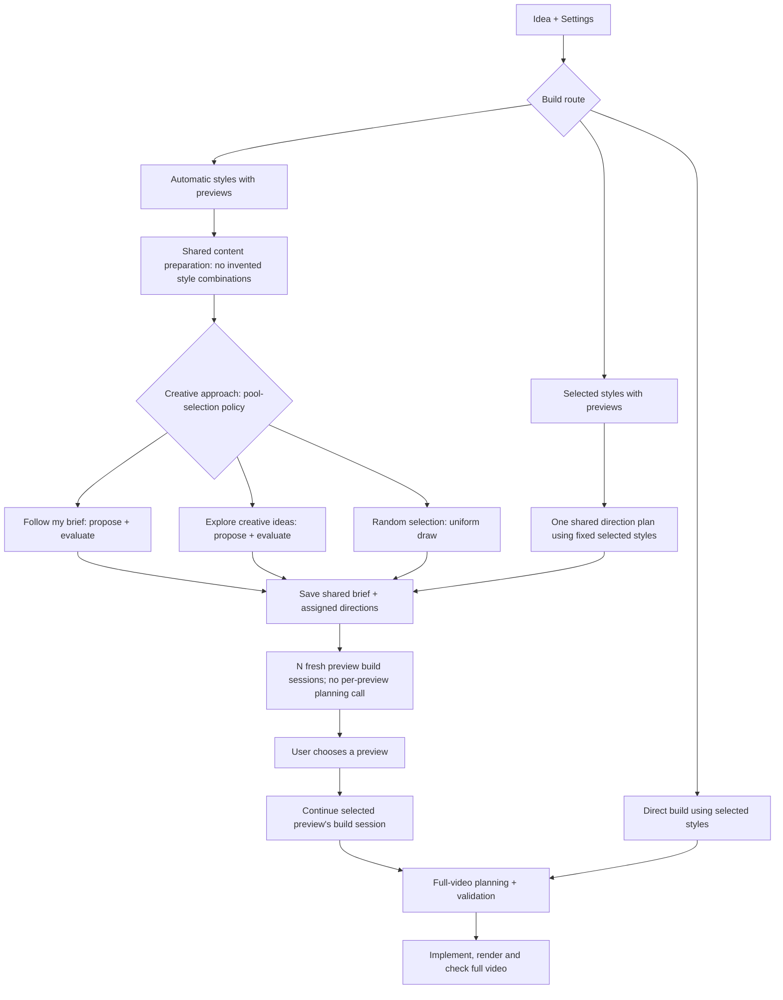

# Build routes and creative approaches

Build routes and creative approaches answer different questions. A creative approach is not a
build route, and changing it must not change the route.

## Build routes: how the project proceeds

The route depends only on Settings-selected Motion Graphics and the requested preview count.

| Settings-selected styles | Preview count | Build route                    |
| ------------------------ | ------------- | ------------------------------ |
| None                     | 1–5           | Automatic styles with previews |
| Present                  | 1–5           | Selected styles with previews  |
| Present                  | 0             | Direct build                   |

Requests without selected styles require previews. Embedded style mentions in the idea do not
become Settings selections and do not change the route.

The route owns whether styles come from pool selection or the user's selections, whether previews
are produced, and when full-video planning starts.

## Creative approaches: how pool styles are chosen

The three creative approaches apply within the automatic-styles route:

| Approach               | Selection behavior                                                                                     |
| ---------------------- | ------------------------------------------------------------------------------------------------------ |
| Follow my brief        | Propose combinations close to the brief, then evaluate and select directions.                          |
| Explore creative ideas | Propose more unexpected combinations while retaining the message, then evaluate and select directions. |
| Random selection       | Draw styles uniformly from the full pool, without proposal scoring or JEV ranking.                     |

Random selection is a selection policy inside the automatic route. It does not introduce another
build route. Currently code performs the uniform draw; builders read the chosen entries' canonical
definitions through Creative Pool MCP. In the other two approaches, the proposal model considers
the catalog and JEV selects directions. Both continue through the same preview/build flow.

When Settings supplies styles, those styles are fixed. Automatic pool-selection approaches are
inactive; the model determines their creative roles from the idea and explicit assignments.

## Flow and planning

For automatic selection, content preparation preserves user-specified visual references but does
not invent combinations. Combinations enter the assigned directions after selection. Each preview
reads its assigned `PREVIEW_PLAN.json` in a fresh build session.

Selected-style direction planning and direct full-video planning receive both Settings-selected
styles and embedded references. Full-video planning after a preview receives the approved
direction and original requirements. Every stage must preserve embedded references' scope—for
example, a style requested only for credits must not become a global selection.

These planning details describe videos. Interactive pages share route selection and style-selection
policies but use their page workflow instead of full-video planning, capture or rendering.

## Ownership and compatibility

- `src/shared/build-route.ts` owns route resolution and labels. Its input contains no creative preference.
- `src/shared/creative-approach.ts` owns the three creative preferences and their labels. It does not inspect selected styles or preview count.
- `src/shared/style-selection.ts` owns selection validation, including incompatible random/pinned or selected-style requests.
- `src/server/jobs/workflow.ts` orchestrates preparation, style selection, previews and full builds.
- `src/server/jobs/subworkflows/explicit-style-preview/` plans executions of fixed selected styles.
- `src/server/jobs/random-directions.ts` implements uniform pool selection.
- `src/server/domains/video/build-plan.ts` owns full-video production planning.

Persisted requests retain their existing fields: `selectedStyleIds`, `candidateCount` and
`preference`. The build route is derived, so old projects need no data migration. UI labels must
describe a route as a route and a creative approach as a creative approach.

For example, changing “Follow my brief” to “Random selection” with no selected styles keeps the
automatic-preview route. Selecting styles and requesting two previews chooses the selected-preview
route. Changing that preview count to zero chooses direct build; it does not change a creative
approach into a route.
