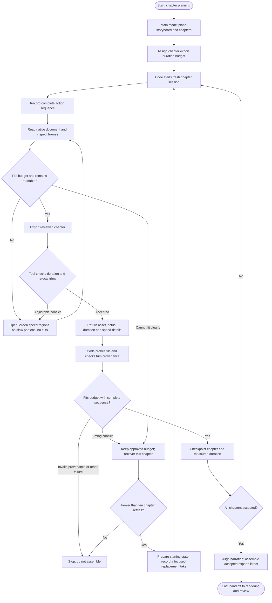

# Chapter capture timing

The main model plans the story and feasible capture budgets before recording.
`estimatedDurationSeconds` is the maximum edited export duration, despite its
historical field name. It must fit the storyboard allocation. Use separate
chapters for footage placed in separated film slots; assembly must not split a take.

Speed up slow typing, repetitive input and waits. Preserve every recorded action
and its order. Return to normal speed for key clicks, readable results and playback;
label accelerated intervals. Inspect native frames around speed boundaries and
framing changes. Export feedback permits correction in the same live chapter
session without recording again.

The tool rejects `addTrims` and `setTrim` during chapter capture, plus exports whose
native provenance contains trims. The shared budget check permits one 60 fps frame
of container rounding. After the model returns, code independently probes the media
and checks cursor-sidecar trim provenance before saving `actualDurationSeconds` in
`CAPTURED_CHAPTERS.json`. Raw recording length is not the edited export budget.

An explicit timing conflict stays inside chapter capture. Code allows at most ten
retries per chapter against the unchanged approved budget. Retry feedback identifies
the overrun and asks the capture worker to fit native speed regions or record a
focused replacement with a planned playback stopping point. Starting-state setup
and control research happen before recording. Valid accepted checkpoints remain
reusable, including captures accepted after a retry; retry feedback is excluded
from their stable cache fingerprints.

All chapters must pass export, duration and provenance checks before narration or
full-film assembly. Exhausted retries, provider failures, cancellation and invalid
provenance stop the workflow. Capture recovery retains the approved storyboard,
chapter budgets and film timing; it never invokes full-film planning.

Owners: `src/server/jobs/subworkflows/chapter-capture/` owns orchestration and
checkpoints; `src/server/capture/chapter-timing.ts` owns timing checks;
`src/server/requests/reference-browser-tools.ts` enforces live tool boundaries.

## Activity

Structured `capture_timing` events belong under the existing chapter parent. They
show actual recording, successful native speed changes, image review, duration
validation, acceptance, conflicts and bounded chapter retries. Acceptance shows
measured export duration against its budget. Repeated phase updates share one row;
a recovered conflict becomes resolved after acceptance. These events never invent
a percentage: the capture bar still counts accepted chapters.
