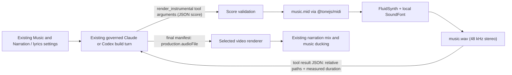

# Local instrumental music

Kiteva can turn a musical score written by the build agent into a WAV file, using
[FluidSynth](https://www.fluidsynth.org/) and a local SoundFont. The agent writes the score during its
existing governed Claude or Codex build turn. There is no separate composer model and the renderer
makes no AI calls. This is separate from [local narration](video-languages.md) and needs no TTS engine,
Python environment, GPU or voice configuration.



## Setup

Install [FluidSynth](https://github.com/FluidSynth/fluidsynth/wiki/Download) using your platform's
package manager or its native distribution, and make sure `fluidsynth` is on PATH. For example, use
`brew install fluid-synth` on macOS or `sudo apt install fluidsynth` on Debian/Ubuntu. On Windows,
install the native executable together with its supporting DLLs. If it is not on PATH, set
`VIDEO_FLUIDSYNTH_PATH` to the full executable path. Rendering opens no audio device and uses no Unix shell.

Then run:

```sh
npm run music:setup
```

This downloads [GeneralUser GS](https://www.schristiancollins.com/generaluser.php) 2.0.3 and its
license into the Git-ignored `models/instruments/generaluser-gs/` folder. Downloads use a fixed
upstream revision and verified SHA-256 hashes, and a failed download leaves no unverified files behind.
Native binaries such as FluidSynth are not bundled with Kiteva. Neither are downloaded SoundFonts.

To use a different local SF2/SF3 bank or executable:

```dotenv
VIDEO_FLUIDSYNTH_PATH=/absolute/path/to/fluidsynth
VIDEO_INSTRUMENT_SOUNDFONT=/absolute/path/to/instruments.sf2
```

Keep that bank's license with your installation. GeneralUser GS has its own license, which includes
its author's notes on where the samples came from. Setup keeps the original text as `LICENSE.txt`.
[FluidSynth](https://github.com/FluidSynth/fluidsynth) is LGPL, and [@tonejs/midi](https://github.com/Tonejs/Midi)
is MIT. Kiteva uses the MIDI package only to write files; it does not install or use Tone.js as an audio engine.

## Existing settings remain authoritative

Use the Music step to request an original instrumental or to provide an existing soundtrack. Keep
voice, language, narration script and lyrics in Narration / lyrics. Instrument rendering does not
translate scripts, synthesize singing or replace your narrator. It does not add music when Music is
off. Uploaded music stays an existing asset, and the agent should not replace it unless you ask.

Tool access depends on the turn
([registry](../src/server/agents/capabilities/registry.ts),
[instruments](../src/server/agents/capabilities/instruments.ts)):

| Turn                                          | `instrument_status` | `render_instrumental` |
| --------------------------------------------- | ------------------- | --------------------- |
| Read-only planning and review                 | Yes                 | No                    |
| Full-video build and its correction turns     | Yes                 | Yes                   |
| Silent preview build and its correction turns | Yes                 | No                    |
| Text-only turns                               | No                  | No                    |

Silent previews can't render instruments, and the preview renderer rejects any preview that contains
audio. The same MCP registration is passed directly to both provider SDKs. For general capability
registration, see the [capabilities README](../src/server/agents/capabilities/README.md).

## How a render works

1. **The model sends tool arguments.** During the build turn, Claude or Codex calls
   `render_instrumental`. The score is that tool call's JSON argument. It is not a separate required
   model response, and no extra composer-model call is made.
2. **The app validates the score** against
   [`InstrumentScoreSchema`](../src/server/audio/instruments/score.ts) and fills in defaults.
3. **[@tonejs/midi](https://github.com/Tonejs/Midi) writes `music.mid`.** Seconds stay authoritative,
   and the library converts them to MIDI ticks using the tempo.
4. **FluidSynth reads the MIDI file and the SoundFont.** It never sees the JSON. FFmpeg then pads or
   trims the audio to the score duration, normalizes loudness with true-peak protection and writes
   `music.wav` ([fluidsynth.ts](../src/server/audio/instruments/fluidsynth.ts)).
5. **The app checks the result.** It probes the WAV and fails the render if the WAV has no audio or its
   length is more than 0.01 s off the score duration. It then writes `provenance.json`.
6. **The tool returns a JSON result** with job-relative file paths and the measured duration
   ([tools](../src/server/agents/capabilities/instruments-tools.ts),
   [result types](../src/server/agents/capabilities/types.ts)).
7. **The model uses the WAV in its video.** It wires the WAV into the selected renderer and names it
   in its final production manifest. See [Using the WAV](#using-the-wav).

### Tool input: the score

The tool takes `{ score: { title, durationSeconds, bpm, tracks } }`. Each track has:

- `name`
- `program`: a zero-based General MIDI program from 0 to 127
- `percussion` (default `false`)
- `volume`: 0 to 1 (default 0.8)
- `pan`: -1 to 1 (default 0)
- `notes`: a list of `{ midi, time, duration, velocity }`

Note `time` is in absolute seconds on the video timeline. `velocity` ranges from 1/127 to 1. Optional
`expression` (MIDI CC11) and `sustain` (CC64) arrays hold `{ time, value }` controls, with values from
0 to 1.

A score can have up to 15 melodic tracks plus one percussion track. `durationSeconds` can't exceed
Kiteva's video-duration limit. Every note and control must fit within `durationSeconds`.

Example `render_instrumental` arguments:

```json
{
  "score": {
    "title": "Calm product intro",
    "durationSeconds": 8,
    "bpm": 90,
    "tracks": [
      {
        "name": "Piano",
        "program": 0,
        "volume": 0.7,
        "pan": -0.2,
        "notes": [
          { "midi": 60, "time": 0, "duration": 2, "velocity": 0.6 },
          { "midi": 64, "time": 0, "duration": 2, "velocity": 0.5 },
          { "midi": 67, "time": 2, "duration": 2, "velocity": 0.55 },
          { "midi": 72, "time": 4, "duration": 3.5, "velocity": 0.5 }
        ],
        "sustain": [
          { "time": 0, "value": 1 },
          { "time": 7.5, "value": 0 }
        ]
      },
      {
        "name": "Bass",
        "program": 32,
        "notes": [
          { "midi": 36, "time": 0, "duration": 4, "velocity": 0.6 },
          { "midi": 43, "time": 4, "duration": 3.5, "velocity": 0.55 }
        ]
      }
    ]
  }
}
```

### Tool result

A successful render returns a JSON object with `kind: "rendered"`. The paths below are illustrative.
Each render creates a new `instrumental-` folder with a random suffix inside the job workspace:

```json
{
  "kind": "rendered",
  "audioFile": "instrumental-a1B2c3/music.wav",
  "scoreFile": "instrumental-a1B2c3/score.json",
  "midiFile": "instrumental-a1B2c3/music.mid",
  "provenanceFile": "instrumental-a1B2c3/provenance.json",
  "durationSeconds": 8,
  "sampleRate": 48000
}
```

`durationSeconds` is the length measured from the finished WAV. `instrument_status` returns
`{ "kind": "status", "available": …, "message": "…" }`. Errors, including missing setup, return an MCP
error result shaped as `{ "kind": "error", "message": "…" }`.

The render folder keeps these files:

| File              | Contents                                                                                           |
| ----------------- | -------------------------------------------------------------------------------------------------- |
| `score.json`      | The validated score, with defaults filled in                                                       |
| `music.mid`       | Tempo-aware MIDI note and controller events                                                        |
| `music.wav`       | Stereo 48 kHz 24-bit PCM, loudness-normalized with true-peak protection                            |
| `provenance.json` | FluidSynth version, SoundFont file name and SHA-256, score SHA-256, sample rate, measured duration |

The tool never runs code written by the agent. It doesn't accept arbitrary output paths or shell
arguments. Cancelling stops child processes and removes partial renders.

## Using the WAV

The score arguments and the tool result are both intermediate data inside the turn. Neither one is the
build turn's output. The turn's final structured output is the usual production manifest
(`pipeline`, `sourceFile`, `audioDescription`, `storyboard` and so on). In that manifest, the model
sets `audioFile` to the returned path, such as `"instrumental-a1B2c3/music.wav"`.

The model must also place the WAV in the selected renderer's audio timeline. HyperFrames and Remotion
compositions must reference the file directly, because setting the manifest field alone adds no sound.
Multiplane receives the file through its existing audio argument
([render.ts](../src/server/domains/video/render.ts)). If prepared narration exists, the app mixes it
in afterwards and ducks the music under the voice ([speech.ts](../src/server/audio/speech.ts)). The
music is a pre-rendered file, not a live synthesizer, so seeking does not restart it. Correction turns
can reuse a WAV that rendered successfully unless the music itself needs to change.

Writing the score and calling the tool happen inside the build turn. They appear in the existing
invocation, session and task event stream, and their usage is recorded in Governance.
