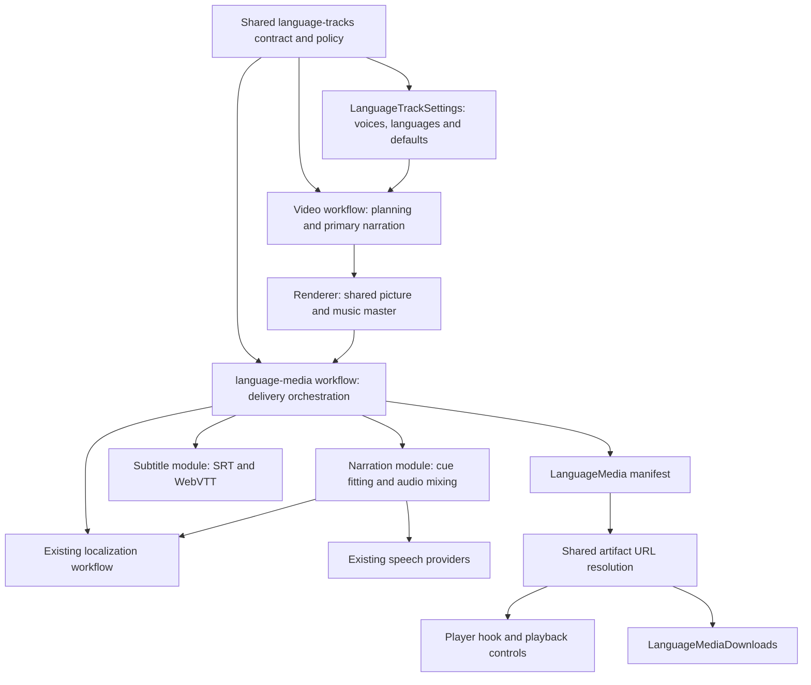
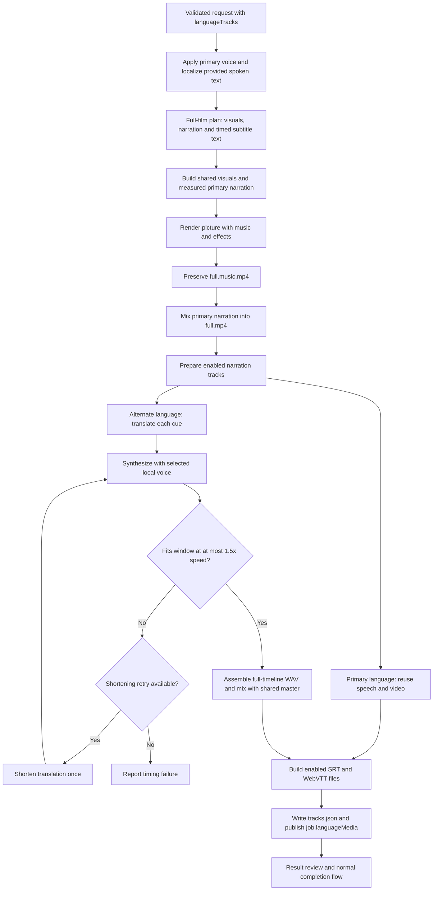

# Language-track architecture

Video language controls authored visual text. The settings UI adds narration languages one at a time, with matching subtitles controlled by one global switch, with the first selected language used initially for playback. Separate narration/subtitle arrays remain in the delivery contract for media generation and older saved requests. Timed script items inherit global narration profiles and subtitle visibility; they contain no per-item language, voice, narration or subtitle controls. A full build produces one visual timeline and separate language media against its measured cue windows. See [the settings and playback guide](video-languages.md) for user-facing behavior.

## Ownership



| Responsibility                                                    | Owner                                                                                  |
| ----------------------------------------------------------------- | -------------------------------------------------------------------------------------- |
| Settings validation, defaults, artifact types and model guidance  | `src/shared/language-tracks.ts`                                                        |
| Primary profile application and production lifecycle              | `src/server/domains/video/workflow.ts`                                                 |
| Preserve the picture/music master before primary narration mixing | `src/server/domains/video/render.ts`                                                   |
| Stable public entry point                                         | `src/server/domains/video/language-media.ts`                                           |
| Track assembly and final manifest writing                         | `src/server/domains/video/language-media/workflow.ts`                                  |
| Cue translation through existing localization                     | `src/server/domains/video/language-media/translation.ts`                               |
| Speech reuse, alternate synthesis, timing and mixing              | `src/server/domains/video/language-media/narration.ts`                                 |
| Subtitle serialization                                            | `src/server/domains/video/language-media/subtitles.ts`                                 |
| Server-local contracts and output locations                       | `src/server/domains/video/language-media/types.ts`, `paths.ts`                         |
| Playback state and native subtitle modes                          | `src/client/use-video-language-tracks.ts`                                              |
| Stateless selectors and download choices                          | `src/client/components/language-playback-controls.tsx`, `language-media-downloads.tsx` |
| Common artifact URL mapping                                       | `src/client/lib/language-media.ts`                                                     |

React components do not translate, synthesize or mix media. The renderer does not choose languages or call translation models. The language-media module reuses localization and speech services rather than implementing provider-specific SDK calls. Claude and Codex use the same track contract and production flow.

## Full-build flow



Alternate narration keeps the primary cue windows. Short cues retain pauses; overlong speech gets one shortening/regeneration retry. A remaining timing failure is explicit. The workflow publishes `job.languageMedia` only after track assembly succeeds; a failure can leave intermediate files but does not publish a completed track manifest to the job.

Subtitles reuse the accepted spoken translation when that language has narration. Timed storyboard captions outside spoken-caption windows are included separately. Per-item subtitle visibility remains part of the source cues. Subtitles are external overlays, so the planner is instructed not to burn them into the visual frames.

The caller's abort signal is passed through translation, local speech and FFmpeg operations. Track generation runs inside the existing video workflow activity scope, **Preparing language tracks**.

## Artifacts and playback

```text
<job workspace>/
  renders/
    full.music.mp4        shared picture, music and effects
    full.mp4              primary narrated output
    full.<language>.mp4   one narration language per MP4
  audio/languages/
    <language>.wav        narration only, padded to the full timeline
    <language>.mix.m4a    narration with music and effects
    <language>.srt
    <language>.vtt
    tracks.json           relative artifact paths and playback defaults
    translations/        project-local translation cache
```

Each language MP4 copies the same video frames and carries one audio mix. This implementation does not mux multiple narration streams into one MP4. Playback switches the MP4 source while restoring the position and play/pause state; subtitle selection independently changes native WebVTT track modes. Downloads offer the matching MP4, narration-only WAV, audio mix and subtitle files. Editable ZIPs include these media files while excluding agent runtime directories.

## Compatibility and verification

Requests without `languageTracks` keep the existing single-language path. Preview builds remain silent. Existing exports are not retroactively translated, and previously burned captions remain in those files. Uploaded recordings are not automatically dubbed. Settings require the backend's `languageTracksSupported` capability flag. Planning's `PROJECT_REQUEST.json`, builder `style-context.json` and the build prompt resolve the same global profiles through `applyLanguageTracks`; original saved requests remain unchanged. Narration MCP profiles are prepared from that resolved request. Global subtitle visibility also governs subtitle exports, regardless of legacy per-item flags.

Focused coverage lives in `tests/language-tracks.test.ts`, `tests/language-media.test.ts` and `tests/language-player-browser.test.ts`: schema and voice validation, localization, subtitle output, real FFmpeg artifacts with matching decoded video frames, timing failure, cancellation, paired language selection, inherited timed-item profiles, and playback position/state restoration. The live local TTS smoke also produced Chinese and English tracks against the same ten-second fixture; it verifies the media path rather than creative video quality.
