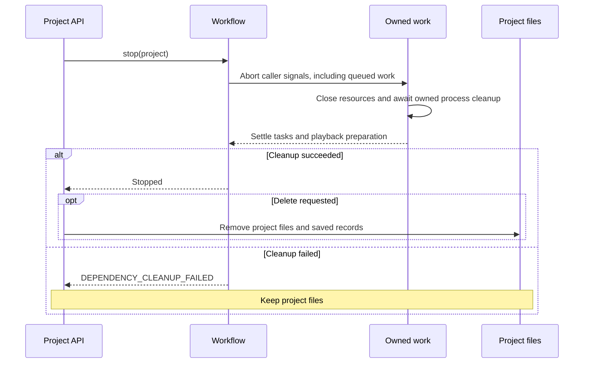

# Project work and cancellation

Stopping or deleting a project cancels its owned work and waits for cleanup. A stop retains
completed artifacts. Deletion removes project files only after owned work settles; a reported
cleanup failure returns `DEPENDENCY_CLEANUP_FAILED` (HTTP 409) and keeps those files.
Other projects and app-owned shared services keep their own lifetimes.

## Stop and delete flow



[Workflow](../src/server/jobs/workflow.ts) tracks preparation, preview/full builds,
refinement copying, auxiliary project work and playback preparation. Its `stop()` aborts work,
awaits task and playback settlements, checks cleanup failures, then reapplies cancelled state.
Queued work receives the caller's signal and can leave the queue before execution.

The [API](../src/server/app.ts) awaits this lifecycle for cancellation and deletion. During
deletion it rejects new project requests with `PROJECT_DELETING`, waits for pending full-build
preparation, and removes data only after stop succeeds. Completed job status does not exempt
its background playback preparation from cancellation. Cancelled playback work is not
resumed automatically after restart.

## Resource ownership

| Resource                                    | Owner and cleanup                                                                                                                                                                                                 |
| ------------------------------------------- | ----------------------------------------------------------------------------------------------------------------------------------------------------------------------------------------------------------------- |
| Claude and Codex SDK subprocesses           | Both adapters use `withProcessScope`; cancellation reaches the SDK and remaining owned subprocess trees are terminated.                                                                                           |
| Reference browser and native recorder       | Browser launch uses `createProcessScope`; native capture closes its MCP connection and owned helpers.                                                                                                             |
| Commands, rendering, installation and audio | Caller signals reach the shared command/process-tree helpers; cancellation waits for cleanup. Serialized speech requests wait for worker cleanup before starting the next request.                                |
| Editable ZIP downloads                      | `Workflow.projectDependency` registers the export. Project stop or client disconnect aborts it and closes its streams.                                                                                            |
| Remote capture                              | The client sends session DELETE on cancellation with an independent, bounded cleanup signal. The worker aborts its session, closes its browser and waits for queued/active actions before removing the workspace. |
| Shared proxy and SDK-home setup             | App-owned rather than project-owned. Cancelling a caller stops its wait/request without shutting down a service used by another project. App shutdown handles service cleanup.                                    |

### Subprocess scopes

[`process-scope.ts`](../src/server/runtime/process-scope.ts) records child-process handles
through Node's `child_process` diagnostics channel, with ownership isolated by async context.
Before forwarding parent cancellation, it snapshots descendant PIDs so immediate SDK shutdown
does not lose helper ownership. SDK shutdown receives 2.5 seconds before remaining owned
process trees are terminated. Closing a scope also drains late-created children.

[`process-tree.ts`](../src/server/runtime/process-tree.ts) shares termination across SDK scopes,
commands, recording and speech. It uses captured PIDs and explicitly owned process groups,
never application-name matching. Unix cleanup escalates from graceful termination to forced
termination and checks for survivors. Windows uses `taskkill /T /F`; Windows runtime behavior
has not been verified on the macOS development host.

This ownership model tracks children created inside the scope and their captured descendants;
it is not a system-wide process supervisor. Process enumeration itself runs outside the owned
scope so cleanup does not register its own helper as another dependency.

### Recorder serialization

Concurrent builds share a recording lock on the recording host. It covers native recording
and saving, while native review, editing and export can continue after release. Lock contention
is cancellable and does **not** guarantee FIFO ordering. See
[shared recorder ownership](chapter-capture-timing.md#shared-recorder-ownership) for timing,
stale-lock recovery and diagnostics, and [worker setup](openscreen-worker.md) for remote capture.

## Adding a dependency

- Pass the caller's `AbortSignal` through queues, SDK/MCP requests, downloads and commands.
- Await resource shutdown in `finally`; do not finish the owning task while cleanup is pending.
- Use `withProcessScope` for SDK turns, or `createProcessScope` when resource creation and
  closing have separate lifetimes. Use the shared process-tree helper for explicit child handles.
- Register project work outside the normal build task through `Workflow.projectDependency`.
- Give cleanup requests their own bounded signal when the original caller is already aborted.
- Keep app-shared services outside project scopes. Do not detach project-owned work without
  a tracked owner and settlement promise.
- Propagate cleanup failures so deletion can retain files rather than report false success.

## Verification

Automated coverage includes [queue cancellation](../tests/work-queue-cancellation.test.ts),
[command cleanup](../tests/runtime-command.test.ts), [process trees](../tests/process-tree.test.ts),
[scope isolation](../tests/process-scope.test.ts),
[both installed SDK cancellation paths](../tests/sdk-cancellation-runtime.test.ts),
[stop/delete and shutdown](../tests/event-stream-shutdown.test.ts),
[playback preparation](../tests/playback-copy-queue.test.ts),
[worker transport](../tests/openscreen-worker.test.ts) and
[project exports](../tests/project-export.test.ts). SDK cancellation probes use local dummy
executables; they do not make model API calls.

The gated [native recording integration](../tests/native-recording-concurrency.integration.test.ts)
uses five independent builders and actual OpenScreen recording, saving, frame review and WebM
export. Run it on a desktop with full Chrome and recording permission:

```sh
KITEVA_TEST_LOCAL_OPENSCREEN=1 npx vitest run tests/native-recording-concurrency.integration.test.ts --maxWorkers=1
```

Local native recording and cancellation were exercised on macOS. Transport tests do not
establish that a remote VM or another operating system records correctly; verify that desktop
separately before relying on it.
