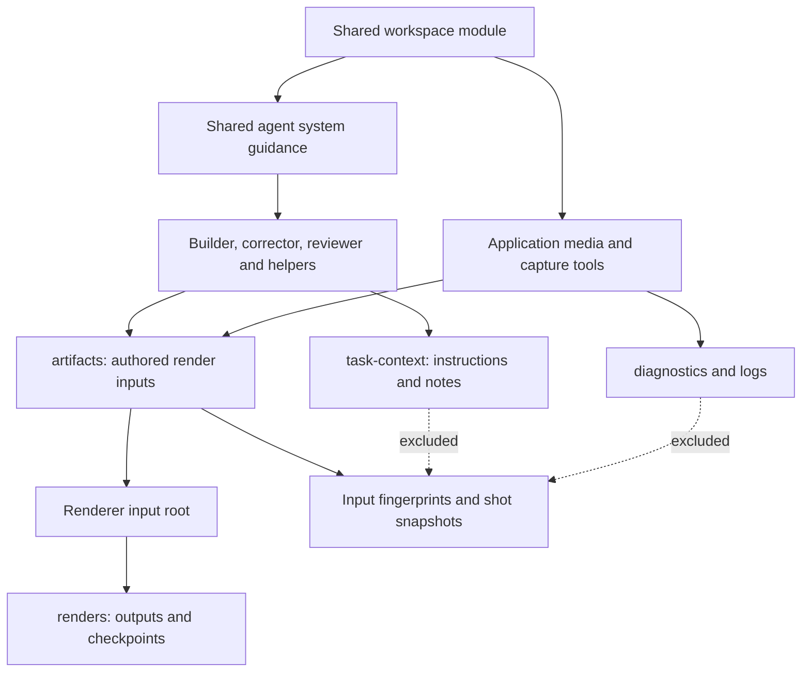

# Project workspace layout

`src/shared/workspace.ts` defines the fixed relative paths without Node-only APIs. `src/server/runtime/workspace.ts` re-exports those constants and owns layout detection, initialization, renderer boundaries and shared agent guidance. This is the single server entry point for the folder contract; browser-safe schemas import the same shared definitions. Import `workspaceFolders` for the versioned constants, `workspacePaths(workspace)` for compatibility-aware paths, `projectArtifactPath(workspace, ...parts)` for authored file names, and `renderInputRoot(workspace)` / `renderSourcePath(workspace, file)` for renderer handoff. Consumers must not infer layout from folder names or repeat directory definitions.

```text
job/
├── artifacts/
│   ├── shots/                authored HTML scenes
│   ├── scripts/              bundled render code
│   ├── styles/               authored styles
│   ├── vendor/               localized libraries
│   ├── components/           installed component-registry source
│   └── assets/               images, fonts, footage, cursor data and audio
├── task-context/inputs/      model invocation context
├── task-context/audio/       speech scripts and synthesis checkpoints
├── task-context/languages/   translation and per-cue task state
├── logs/                     tool and process logs
├── diagnostics/              inspection/debug reports
├── renders/                  final outputs and renderer checkpoints
└── .runtime/                 isolated homes, caches and temporary files
```

The application creates `.kiteva-layout.json` for versioned jobs. New jobs carry `workspaceLayoutVersion: 1`; copies and refinements inherit the source layout. Existing jobs without a version marker retain their saved paths. Merely creating a folder does not silently migrate an existing project. Running jobs are never reorganized during deployment.

The shared `agentTurn` system prompt reads the contract from the workspace module, so builders, correctors, reviewers, capture and audio helper turns receive the same boundary. File-backed invocation inputs are saved under the exported task-context path. Renderer contracts produce workspace-relative source paths such as `artifacts/shot.html`; URLs inside authored HTML are relative to the artifact render root. Run initialization and bundling commands inside that root. Technology preparation tools also write JavaScript/CSS bundles there and return import statements relative to that render root; page setup places motion-runtime.js there before the builder runs. Capture prompts use the workspace module’s actual asset directory and browser tools preserve returned paths. Correctors edit the affected artifact in place.

Requirements, plans, manifests, storyboard and narration configuration/state remain application-owned metadata at the exact paths supplied by the application. Agents read them while authoring; rendered pages must not load them as assets. This preserves their current typed readers without putting task metadata in cache evidence. Model-only working notes belong in task-context. Copy any source data actually needed by the renderer into artifacts before referencing it.

The public page preview URL keeps its stable /index.html and relative resource URLs. The page-serving route resolves them against the declared artifact root and rejects links escaping that root.

Native renderers run with the artifact input root, while final exports and diagnostics stay outside it. Path checks reject traversal and links escaping that root. Multiplane cache fingerprints and recovery snapshots hash only the declared artifact tree, together with existing settings/runtime checks. Dynamic dependencies outside the tree remain invalid rather than becoming an excuse to hash task context. New task JSON, logs and diagnostics do not invalidate a shot; edited HTML, CSS, JavaScript or media inside artifacts do.

Refinement reference images use the shared media role (artifacts/assets/refinements in versioned jobs). Component-registry installs use the shared components role under artifacts; existing traversal, symlink and unique-install checks still apply.

Narration WAVs (including the older speech preparation path), Audio Studio output, browser screenshots, downloaded reference assets and native capture media use workspace-owned media paths. Speech checkpoints, script JSON and concat lists stay in task-context/audio; nested speech tasks publish WAVs into the owning project’s artifacts/assets/audio/speech with separate scopes. Additional language delivery WAVs, mixes and subtitle files go to renders/languages, while translation and cue task state use task-context/languages. Debug traces and capture diagnostics use diagnostic paths. Editable exports omit task context, logs, diagnostics and runtime state while retaining authored artifacts and the applicable manifest/storyboard/dependency declarations.

The remote capture worker has an ephemeral transfer workspace, not a versioned project. Its temporary asset storage uses the shared legacy layout constants; the client maps downloads into the destination project’s media or diagnostics role. Application catalog assets are installation resources rather than project inputs and are not relocated.



Verification uses local fixtures and mocked provider responses. No provider credentials or live external API calls are permitted in tests.
