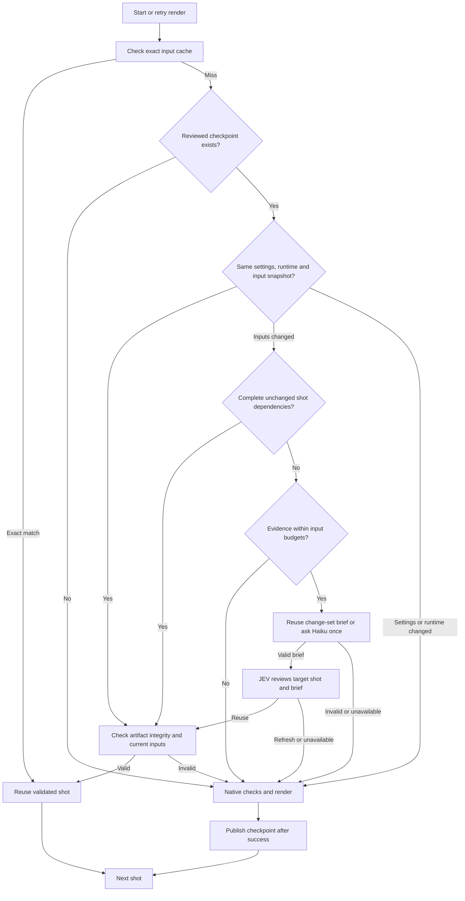

# Render cache recovery

Multiplane saves a checkpoint after each shot passes its configured native checks and renders successfully. A failure late in a full film or preview therefore leaves earlier checkpoints available for the next attempt. Failed shots are never checkpointed. Final assembly and audio mixing run again using the accepted shot outputs.

Haiku receives one change set, without repeating unchanged per-shot source context. Its user prompt is limited to 48 KiB before any SDK call, with at most 1,000 changed files and an 8,000-byte changed-path list. Oversized evidence skips model review and renders the shot directly; it is never silently truncated. Code checks that the output names every changed file exactly once and stays within 16 KB.

The brief is independent of the target shot. Concurrent shots with the same change set and abort signal share one promise, including failures, so a failed summary is not paid for repeatedly within that render. Valid briefs are also saved and reused across render attempts, keyed by their change evidence, model and summary format version. Changed evidence invalidates the summary. JEV still makes a separate decision for each shot using that shared brief, the shot's source context, unchanged settings and dependency completeness. Per-shot evidence is limited to 11,000 bytes before calling Haiku, reserving space for the brief inside JEV's 28 KB state limit. Invalid summaries, uncertainty, unavailable models and review failures force refresh. Exact input matches and complete unchanged dependency graphs need neither Haiku nor JEV.

Raw evidence and its accepted brief are saved under the project workspace's `renders/cache-reviews/` directory for audit. This generated directory is excluded from input snapshots, so recording a review cannot itself invalidate the cache.

The application checks output hashes and unchanged inputs independently of JEV. Settings and renderer/runtime changes cannot be overridden by the review. Snapshots reject symlinked inputs and exclude generated `renders/`, private `.runtime/`, Git state and separately fingerprinted dependencies. Private runtime, Git and dependency directories are excluded at every depth, including `audio/.runtime/`. All dot-prefixed paths are excluded from Haiku and JEV input. Other hidden files remain in integrity snapshots: if review would require their changes or source context, code renders directly without sending them to a provider. Footage frames and other authored media remain render inputs; large frame changes trigger the input-budget fallback rather than being ignored. Checkpoint metadata and video bytes live under the existing project-local `renders/multiplane-cache/` tree and follow its refinement/export rules. Publishing invalidates the previous pointer before replacing video bytes, so interruption produces a cache miss instead of mismatched metadata.

The existing static dependency cache remains the first path. Reviewed checkpoints also support shots whose dynamic resource use prevents a complete static dependency graph. A review is scoped to one cached shot and input change; approvals are retained against the new snapshot. Render retries and backend restarts can reuse these checkpoints without depending on a process ID or provider-login token.

The orchestrating render caller forwards Haiku summary and JEV review invocation, usage and decision events to Governance. The summary module lives in `src/server/jev/strategies/render-cache/brief.ts`, the decision strategy in `src/server/jev/strategies/render-cache.ts`, and checkpoint storage in `src/server/rendering/multiplane/recovery-cache.ts`. Native validation policies remain in renderer metadata.

Tests cover a 50-shot failure at 98%, unchanged dynamic resources, nested private runtime directories, unchanged complete dependency graphs, retained footage inputs, oversized input rejection before provider calls, concurrent and persisted summary reuse, bounded and complete briefs, JEV reuse/refresh, unavailable review, corrupt artifacts, changed settings/runtime, input changes during rendering and cancellation. Codebase tests and verification scripts must never use real provider tokens or call any live external API. Vitest blocks external fetch requests by default; local fixture endpoints and explicitly mocked transports remain available. Cache tests inject review decisions; summary and API strategy tests mock Haiku and JEV calls.

Previously completed shots without checkpoint metadata cannot be adopted safely just from their output filenames. The mechanism applies to checkpoints written by this version; it does not silently trust older untracked render outputs.
