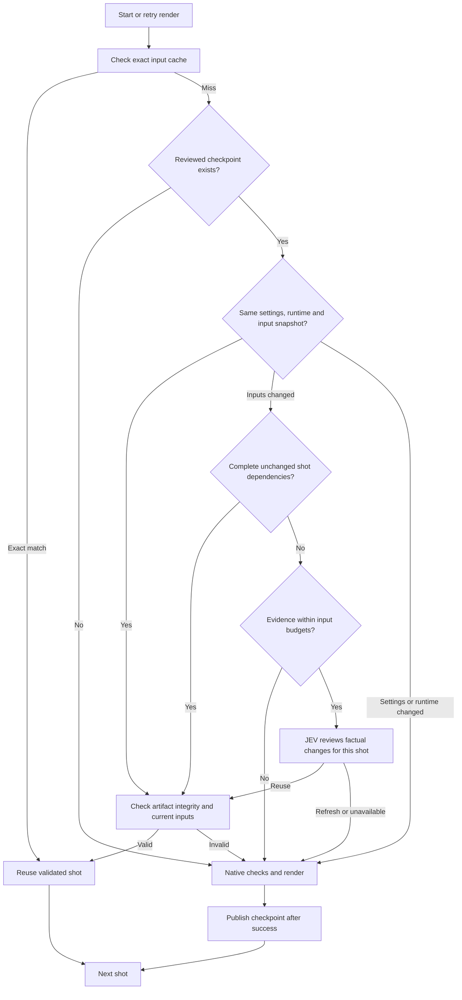

# Render cache recovery

Multiplane saves a checkpoint after each shot passes its configured native checks and renders successfully. A failure late in a full film or preview therefore leaves earlier checkpoints available for the next attempt. Failed shots are never checkpointed. Final assembly and audio mixing run again using the accepted shot outputs.

Cache review no longer calls Haiku. Code constructs factual per-shot evidence: unchanged render settings, dependency hashes, current source, and forward/reverse JSON Patch operations over changed text lines. Reverse patches preserve removed content. Text snapshots include JSON, Markdown and other supported text formats, so orchestration changes need not be represented by hashes alone. Binary inputs retain hashes and explicit content limitations.

Existing compiler tooling compacts JavaScript and CSS source; no generated prose or filename-based impact classification is used. Every changed path remains in the evidence. Complete unchanged dependency graphs reuse directly without any model. For incomplete graphs, JEV must establish the target shot's dynamic dependencies from the source and refresh when that shot's impact cannot be established. There is no shared-summary uncertainty flag overriding JEV's shot-specific decision.

The evidence state is bounded to 28,000 UTF-8 bytes, leaving room for the Choice question within the request limit. Oversized evidence is never silently truncated: code skips the API call, records the measured size and limit, and renders the shot. Review errors also record their actual reason. Existing brief files are historical records and are no longer read or generated.

For versioned workspaces, snapshots and dependency scans use only the artifact root exported by the [workspace module](project-workspace.md). Task context, logs and diagnostics are outside that input boundary; their changes do not trigger a review. Existing workspaces retain legacy handling until explicitly migrated.

The application checks output hashes and unchanged inputs independently of JEV. Settings and renderer/runtime changes cannot be overridden by the review. Snapshots reject symlinked inputs and exclude generated `renders/`, private `.runtime/`, Git state and separately fingerprinted dependencies. Private runtime, Git and dependency directories are excluded at every depth, including `audio/.runtime/`. All dot-prefixed paths are excluded from JEV input. Other hidden files remain in integrity snapshots: if review would require their changes or source context, code renders directly without sending them to a provider. Footage frames and other authored media remain render inputs; large frame changes trigger the input-budget fallback rather than being ignored. Checkpoint metadata and video bytes live under the existing project-local `renders/multiplane-cache/` tree and follow its refinement/export rules. Publishing invalidates the previous pointer before replacing video bytes, so interruption produces a cache miss instead of mismatched metadata.

The existing static dependency cache remains the first path. Reviewed checkpoints also support shots whose dynamic resource use prevents a complete static dependency graph. A review is scoped to one cached shot and input change; approvals are retained against the new snapshot. Render retries and backend restarts can reuse these checkpoints without depending on a process ID or provider-login token.

The orchestrating render caller forwards JEV invocation, usage and decision events to Governance. Cache-review decisions and actual checkpoint restore outcomes are recorded separately, so approval is not mistaken for a successful restore. Evidence construction lives in `src/server/jev/strategies/render-cache/evidence.ts`, the decision strategy in `src/server/jev/strategies/render-cache.ts`, and checkpoint storage in `src/server/rendering/multiplane/recovery-cache.ts`. Native validation policies remain in renderer metadata.

Tests cover a 50-shot failure at 98%, unchanged dynamic resources, nested private runtime directories, unchanged complete dependency graphs, retained footage inputs, compact/reversible evidence, large shared source, explicit budget rejection, JEV reuse/refresh, unavailable review, corrupt artifacts, changed settings/runtime, input changes during rendering and cancellation. Codebase tests and verification scripts must never use real provider tokens or call any live external API. Cache tests inject review decisions and strategy tests mock JEV; a mocked agent provider verifies that no Haiku call occurs.

Previously completed shots without checkpoint metadata cannot be adopted safely just from their output filenames. The mechanism applies to checkpoints written by this version; it does not silently trust older untracked render outputs.
