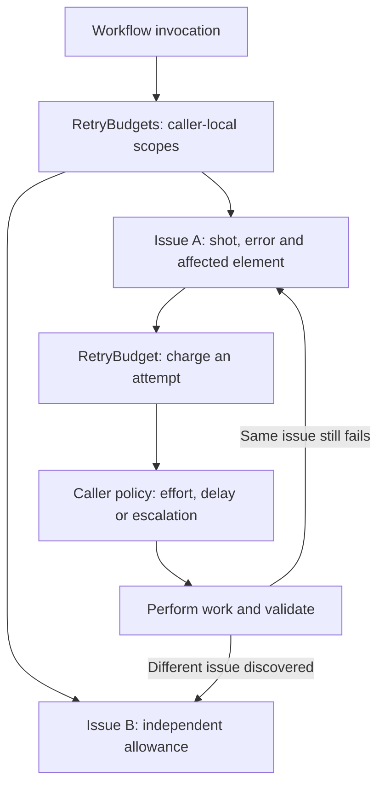

# Retry budgets and repair ownership

Application-owned attempt counting uses `src/shared/retry-budget.ts`. `RetryBudget` charges a bounded operation; `RetryBudgets` keeps separate counters for caller-defined keys. Each attempt has a zero-based policy index, a one-based display number and a remaining allowance. Cancellation can be checked before charging. Iterating an exhausted budget never resets it.

## Scope

Initial preview and full-video outputs whose manifest is valid but whose storyboard fails application validation enter the same video corrector before rendering. The original session, manifest and display copy are preserved, and all storyboard validation findings are supplied as one structured repair task. Validation is not relaxed. Cancellation and non-storyboard output failures propagate normally.

Video budgets belong to the issue, not the film or check batch. Each Claude issue gets ten Haiku attempts: three medium, three high and four xhigh, followed by at most two main-model attempts. Codex retains 20 lightweight attempts for eligible issues and two main attempts, or five main attempts for GPT-6.1 full videos. Each issue owns its allowance independently. Sessions remain shared; sharing context does not share retry counts.

`src/server/agents/correction-identity.ts` identifies renderer issues using renderer, check stage, code, source file and affected selector/reason when supplied. New report filenames, timestamps and pixel counts do not make a new issue. Multiplane errors carry the shot path even when the native command returns only a failure result. Other structured findings use their source/selector/scene and description; plain errors use their message. Defects without distinguishing evidence conservatively share that identity.

Page validation allows two repairs per issue after initial generation. Brief asset review retains 20 repairs per scene/asset issue. Chapter timing retries remain per chapter. Brief patch validation and plan schema correction retain their per-operation limits. Collections live for their workflow invocation; a deliberate user retry starts a new invocation.

## Consumers

| Area                                                          | Scope and policy                                           |
| ------------------------------------------------------------- | ---------------------------------------------------------- |
| Video corrections, both providers                             | Per issue; effort and tier limits above                    |
| Page validation                                               | Per validation issue                                       |
| Brief asset review                                            | Per scene/asset issue; three attempts for review structure |
| Guarded brief edits                                           | Three attempts per assigned edit operation                 |
| Video build-plan validation                                   | Three attempts per planning operation                      |
| Chapter timing recovery                                       | Ten retries per chapter                                    |
| Alternate narration timing                                    | Two synthesis attempts per cue                             |
| Provider capacity recovery                                    | Initial call plus three retries; existing backoff delays   |
| Technology and speech readiness                               | Two checks per dependency/provider operation               |
| Proxy startup and native-render verification polling          | Existing 50/600-check bounds                               |
| Catalog review, example generation and preview repair scripts | Existing three/two/three-attempt policies per operation    |

SDK and downloader transport retries remain native: Claude emits its SDK retry events, Codex configures native request/stream retries, JEV configures client retries, and Hugging Face/curl own their download retries. Kiteva does not wrap those transport events in an additional application retry loop. Lock waiting, stream reads and process-shutdown waits are cancellation/timeout-driven waiting, not counted repairs. This change adds no attempt limits to them.

## Verification

`tests/retry-budget.test.ts` covers exhaustion, numbering, cancellation, independent scopes and conflicting limits. `tests/correction-identity.test.ts` covers stable identity across regenerated reports and separate sources. `tests/video-corrector.test.ts` tests both providers: exhaust one shot, repair another with its full allowance, then confirm the first stays exhausted. Existing chapter, brief, page, capacity, speech and renderer tests cover their retained policies.
