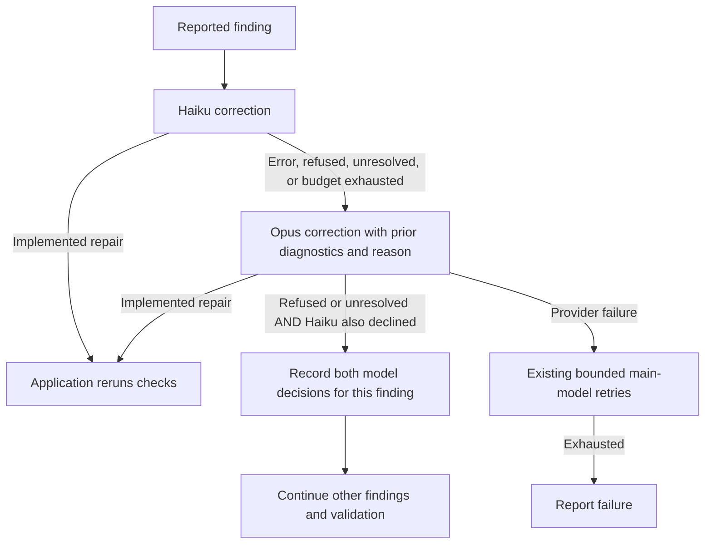

# Video correction outcomes

Every correction response includes `correctionOutcome: { status, reason }`. Status is `fixed`, `refused`, or `unresolved`; a nonblank reason is required. `fixed` means the agent implemented the repair, not that application QA has passed. A refusal or unresolved outcome requires no replacement manifest or storyboard and is never merged into the accepted production.

This escalation change applies to Haiku correction. Completed Haiku attempts still use the existing per-issue effort/budget policy; an exception or declared non-repair escalates immediately to Opus. Cancellation and input questions propagate immediately. A transport error is not a model decision and cannot by itself authorize bypass.

Both models must explicitly report `refused` or `unresolved` to bypass a finding. The job persists their model names, statuses, reasons and the existing correction identity in `correctionBypasses`. The same identity function is shared with correction budgets and used by rendering checks and finished-result review. No filename or message-keyword rules classify a failure as ignorable. Other findings remain actionable and are still corrected. GPT correction retains its existing budget behavior and does not acquire the Claude dual-model exception.

Multiplane verification and HyperFrames composition QA may continue past the recorded finding, with warning events. Native diagnostic files retain the failed evidence; the exception does not rewrite them as passing. Finished-result review uses the same exception matching. Checkpoint keys include the exception identities so a shot accepted under exceptions is not restored under a different validation policy. There is no global validation-disable flag. Missing reports, unrecognized process failures and failed exports without usable output still fail rather than loop or fabricate a successful video.

The implementation is split between the shared output schema (`src/shared/agents/schemas/video-correction.ts`), correction orchestration (`src/server/domains/video/corrector.ts`), and shared exception handling (`src/server/domains/video/correction-bypass.ts`). Tests mock model responses and native failures; they never use real API tokens or external APIs.
