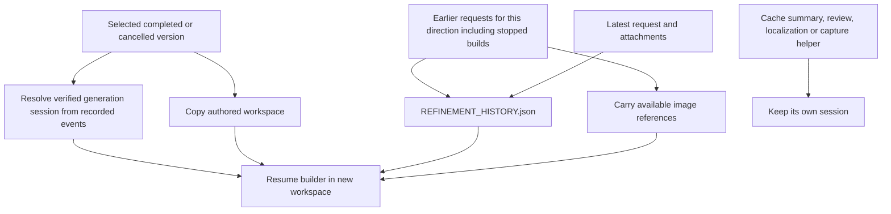

# Fine-tune continuity

Each fine-tune creates a version with its own editable workspace. The source selector includes completed and cancelled full-video versions that have a saved builder session, with cancelled versions labelled explicitly. It copies the selected version's authored files and verified renderer cache, preserving earlier outputs. It resumes that version's verified generation session rather than opening a disconnected conversation or resuming a helper.

Submitted fine-tune instructions remain active by default when their build is cancelled, interrupted or fails. Before submitting a new refinement, expand **Earlier refinement requests** and uncheck any request to discard. The saved choice applies to subsequent refinements in that direction and can be reversed by checking the request again. Unchecking withdraws the instruction; it does not undo changes already in the selected source video. New versions collect previous instructions from full-video jobs in the same direction, in submission order. Other directions and previews are excluded. Stored history is deduplicated by originating job ID, so carrying it through several versions does not repeat requests. The latest fine-tune message remains separate for Conversation and Edit brief.

The new workspace contains `renders/REFINEMENT_HISTORY.json` with retained previous requests, their known timestamps and image IDs, discarded request IDs, and the newest request. The build prompt instructs the model to read this file and preserve retained requirements unless a later request explicitly replaces or withdraws them, and ignore discarded requests even if they remain in the resumed session. Requests from other stopped versions are instructions, not evidence that their changes exist in the selected source. Selecting a cancelled version itself preserves that version’s partial authored files and resumes its verified builder session; the original cancelled version stays saved. The history file is orchestration metadata under `renders/`, alongside the revision checkpoint, so writing it does not invalidate inherited render inputs. Images associated with earlier requests are copied from available stored assets as well as the new attachments; unresolved asset IDs are recorded honestly.

Generation-session ownership belongs to generation orchestration. `generationSessionEvents` is bound only around the actual page/video builder and planning calls. Main correction orchestration already owns its session updates; cheap corrections keep a separate correction session. The shared event recorder only records events and never changes a job's generation session, so adding a future helper cannot overwrite it.

When an older saved version has a contaminated session ID, `Store.generationSessionId` retrieves its most recent recorded generation or main-correction session. A legacy session without event history remains supported. An ID positively identified as a helper is rejected if no verified builder session is available. Historical source records and completed files are preserved; selecting a version resolves the right session for the new job and checkpoint.

Tests use mocked generation calls and local image/workspace fixtures for both Claude and Codex. They cover stopped requests, attachments, repeated refinements, direction isolation, session provenance and helper exclusion. No real provider API is called.

## Deleting versions

A trash icon beside the version buttons deletes the selected finished, failed or stopped video version after confirmation. Deletion is unavailable while any project work is running. The server checks this again, removes only the version’s owned workspace, and saves a deletion record so its refinement request cannot return through a later version’s copied history. Other version workspaces and the event audit remain intact.

Version numbers are persisted per direction with a high-water counter. Deleting v2 from v1/v2/v3 leaves v1/v3; the next build is v4. Deleting the highest or every version also preserves the counter. Legacy jobs receive their existing displayed numbers before any deletion.
