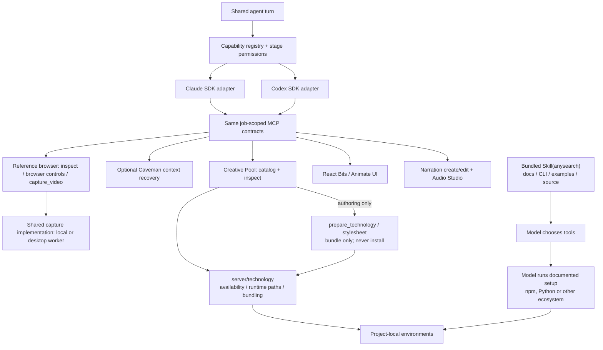

# Built-in agent capabilities

These are MCP tools registered directly with the Claude Agent SDK and Codex SDK on each turn.
They are separate from authoring skills (`../bundled-skills/`), Motion Graphics and rendering engines.

| Capability                                                              | Registration                                     | Guidance                                 | Implementation                                                                                                                                                                   |
| ----------------------------------------------------------------------- | ------------------------------------------------ | ---------------------------------------- | -------------------------------------------------------------------------------------------------------------------------------------------------------------------------------- |
| [Reference browser](reference-browser/)                                 | [capability.ts](reference-browser/capability.ts) | [prompt.ts](reference-browser/prompt.ts) | [tools.ts](reference-browser/tools.ts), [server.ts](reference-browser/server.ts), [tool-registry.ts](reference-browser/tool-registry.ts), [types.ts](reference-browser/types.ts) |
| [Context recovery](context-recovery/)                                   | [capability.ts](context-recovery/capability.ts)  | Existing Caveman turn guidance           | External Caveman MCP; proxy lifecycle remains in `agents/caveman.ts`                                                                                                             |
| React Bits                                                              | [capability.ts](react-bits/capability.ts)        | [prompt.ts](react-bits/prompt.ts)        | [tools.ts](react-bits/tools.ts), [server.ts](react-bits/server.ts)                                                                                                               |
| Animate UI                                                              | [capability.ts](animate-ui/capability.ts)        | [prompt.ts](animate-ui/prompt.ts)        | [tools.ts](animate-ui/tools.ts), [server.ts](animate-ui/server.ts)                                                                                                               |
| Creative Pool                                                           | [capability.ts](creative-pool/capability.ts)     | [prompt.ts](creative-pool/prompt.ts)     | [tools.ts](creative-pool/tools.ts), [server.ts](creative-pool/server.ts)                                                                                                         |
| Narration                                                               | [capability.ts](narration/capability.ts)         | [prompt.ts](narration/prompt.ts)         | [tools.ts](narration/tools.ts), [server.ts](narration/server.ts)                                                                                                                 |
| [Audio Studio MCP](https://github.com/kanaworksai-hue/audio-studio-mcp) | [capability.ts](audio-studio/capability.ts)      | [prompt.ts](audio-studio/prompt.ts)      | [tools.ts](audio-studio/tools.ts), [server.ts](audio-studio/server.ts), [client.ts](audio-studio/client.ts)                                                                      |

`registry.ts` collects registrations and guidance. Text-only calls receive neither. Planning/review
calls (`readOnly: true`) get `search_components` and `read_component`; build/correction calls also get
`install_component`. The planning server does not register the installation tool, independent of
provider permissions or prompt compliance. No user/global MCP configuration is modified.

## Capability architecture



All Kiteva-owned tool servers register tools with `McpServer.registerTool()`. Narration and the
Audio Studio adapter use `shared/service-tool-input.ts` to publish their existing service-owned
JSON schemas through Zod metadata while forwarding object arguments unchanged. Narration's
service and Audio Studio's upstream server retain validation, defaults and structured errors;
the adapter must not strip extra properties or apply defaults before forwarding. Narration retains
its serial create/edit queue, cancellation and activity tracking. Audio Studio retains the upstream
allowlist, instructions, metadata, workspace path checks and request cancellation.

Tool contracts and responses are shared across providers; SDK permissions and events are adapted
at the boundary. Installation belongs to model execution, not to an MCP dependency manager.
[Architecture and research boundaries](../../../../docs/architecture.md#technology-capabilities-and-project-setup)
cover the complete flow. Provider events use shared activity categories; UI groups do not follow
execution-scope nesting.

## Folder layout

```text
capabilities/
├── registry.ts
├── reference-browser/      # Registration/prompt/server/tools/types, tool registry and browser support
├── context-recovery/      # External MCP registration; proxy lifecycle stays with Caveman
├── animate-ui/
│   ├── capability.ts
│   ├── prompt.ts
│   ├── server.ts
│   └── tools.ts
├── react-bits/             # Same registration/prompt/server/tools layout
├── creative-pool/          # Same layout, plus capability-specific types.ts
├── audio-studio/           # Same layout, plus client.ts and types.ts
├── narration/              # Registration/prompt/server/tools; shared audio types live in audio/
└── shared/
    ├── types.ts
    └── component-registry-tools.ts
```

Browser tools retain the `reference_browser` MCP name and all existing tool names. The shared registry owns stage availability for both providers; adapters no longer register browser tools separately. The browser capability owns tool contracts, guidance and browser support; `server/capture/` and the website capture workflow retain recording/worker orchestration. Context recovery keeps its existing text-only exception and provider proxy configuration.

Each capability owns its registration, system guidance, server entry point, tools and specific types.
The root registry only collects capabilities. Shared types and the component-registry adapter stay in
`shared/` because multiple capabilities consume them.

## Animate UI and authoring resource selection

`animate_ui` exposes the official [Animate UI registry](https://animate-ui.com/docs/mcp) through the
same controlled registry adapter as React Bits. Planning exposes `search_components` and
`read_component`; building also exposes `install_component`. The tool saves source, declared
dependencies, provenance and the upstream license under `components/animate-ui/` without running
scripts, installing packages or trusting upstream target paths. The official `@animate-ui/react`
package is available locally. Source with other missing dependencies must be adapted or reported;
it must not silently change the renderer or claim installation makes every dependency available.
The upstream MIT + Commons Clause terms apply to imported component source.

Before a new job's model turn, JEV evaluates Animate UI, React Bits, installed bundled skills and
existing local code against the actual brief, chosen Motion Graphics, renderer and available
packages. One native Choice API question selects exactly one primary resource from all alternatives,
without per-resource yes/no thresholds or a fixed weighting scheme. Ordinary local code remains
available to implement the chosen approach. The selected IDs and decisions are saved on the job and supplied as
`authoringResources` in `style-context.json`. This selects authoring resources, not Motion Graphics,
and does not replace the main model's production plan or disable tools. Existing completed renders
resume without a new selection call. JEV failure is recorded as a warning with a limitation; it does
not block generation. Invocation and usage use the same Workflow/Governance event path as other
JEV calls. Both providers receive the decision and renderer-specific usage guidance. Video effects
must be adapted to deterministic composition time; interactive pages retain accessibility and
reduced-motion behavior.

## Creative pool lookup

The internal `creative_pool` server provides `search_pool` and `read_pool_entry` to both SDKs during
planning, building and repairs. It reads the application's current Motion Graphic, motion and
technology catalogs locally. Search returns matching IDs and names; reading returns authoring definitions, including sequences,
constraints and implementation guidance, in both text and typed structured content. Source-review
and provenance fields are omitted without changing the catalogs. `includeCreativeAlternatives`
on the agent turn is passed through the shared capability registration to the MCP server as
`KITEVA_POOL_INCLUDE_ALTERNATIVES`. Automatic exploration defaults to true. Fixed-style preview
direction planning, selected-direction video planning, builds, repairs and result reviews pass false
to omit `motion_graphic_variants` and `suggested_combinations`. The model cannot override this
workflow-controlled filter with a tool argument. It writes no files and makes no network requests. Guidance requires reading named
definitions before implementation while preserving explicit user refinements and supplied assets.
Tool availability and instructions do not by themselves prove that the rendered motion is faithful;
the finished composition still needs visual verification.

Authoring handoffs carry selected IDs and primary/supporting roles, without embedded style definitions
or resolved catalog executable templates. Both providers receive shared system guidance to call
`read_pool_entry({ kind: "motion_graphic", idOrName: selectedId })` for every selected ID before
planning or implementation. Known IDs need no search; names in the original idea are resolved through
`search_pool`, then read in full. Production parameters and renderer contracts remain in the handoff;
catalog video examples do not override page interactions or the chosen renderer. The main model
interprets the full definitions, preserves draft roles and user act assignments, and records their
contributions in the storyboard. These are model instructions, not a host-enforced read gate. There
are no read receipts, style-scope contracts, quote-matching validators or forced style-planning turns.
The normal rendering and final-result review workflow remains responsible for delivered quality;
tool availability and guidance alone do not guarantee model compliance or visual fidelity.

React Bits publishes a [shadcn-compatible registry](https://reactbits.dev/get-started/mcp).
Kiteva's small MCP adapter reads that registry directly over HTTPS rather than launching the general
shadcn CLI. It fixes the upstream origins and rejects redirects, arbitrary URLs and unsafe file paths.
Search returns every matching variant; it has no hidden result cap. Source lookup is cached in memory
for the lifetime of that server. Network failures are tool errors; the model can continue with local
assets instead of treating React Bits as a prerequisite for generation.

Installation saves only the chosen component into a fresh
`components/react-bits/<variant>/<source-hash>-<unique-id>/` directory in the job workspace. It retains
source paths, complete registry JSON, declared npm dependencies, origin, SHA-256 and the upstream
license. Upstream `target` paths are ignored. Existing source is never overwritten, linked destination
directories are rejected, and downloaded scripts are never executed. This tool installs source files,
not npm packages: agents must reuse available dependencies or report missing ones. Additional registry
dependencies need explicit inspection rather than automatic recursive downloads.

The [React Bits license](https://github.com/DavidHDev/react-bits/blob/main/LICENSE.md) is MIT with a
Commons Clause restriction, not unrestricted MIT. Keep the downloaded notices with substantial copies;
do not redistribute the component collection. No upstream component code is bundled in Kiteva.

The provider adapters keep their existing event path. Tool events and usage carry the same invocation,
model, session and task attribution into Workflow/Governance. The adapter makes no AI calls and adds no
separate model billing path. Customer Activity shows only curated component-action labels.

## Narration MCP

Configured narration jobs expose `create_narration` and `edit_narration` during build and correction
turns for both SDK providers. Planning, review and text-only turns receive no narration tools.
The orchestrator registers voice profiles without generating audio. The model creates initial speech
through `create_narration`, which saves `audio/narration.json`; subsequent edits read its cue IDs,
measured durations and revision before editing. Timing changes reuse the recorded audio. Text changes
use the existing speech provider to regenerate only the changed cue, retaining configured voices,
language, speed and volume. Creation replaces the narration with a new set of cues.

The audio service rejects stale revisions, overlapping measured cues, film overruns and paths outside
the job workspace. Tools return readable text and typed structured content. Shared schemas belong to
`audio/narration-types.ts`, alongside the service consumed by both MCP and orchestration. Before
rendering, the workflow reloads the accepted narration track; Kiteva still owns final speech/music
mixing and validation. The model must reconcile captions and visual timing with the returned cues.

## Audio Studio MCP

[Audio Studio MCP](https://github.com/kanaworksai-hue/audio-studio-mcp) is a separate local audio
capability for both SDK providers. It does not replace the renderer or the visual-resource selection.
`audio-studio/capability.ts` registers the workspace adapter, `audio-studio/client.ts` probes upstream MCP
startup/tools, and `audio-studio/tools.ts` forwards the upstream tool schemas and server instructions.
Read-only planning/review and text-only turns receive no audio tools. Build turns expose
`generate_audio`, `edit_audio`, `process_audio` and `unload_models` when installed.

Run the root [install.sh](../../../../install.sh) for app and Audio Studio setup together. For a
standalone setup, use the upstream installer in `.data/audio-studio-mcp`, or set `AUDIO_STUDIO_MCP_COMMAND` to an
absolute executable path from an existing installation. Kiteva automatically detects
`.data/audio-studio-mcp/.venv/bin/audio-studio-mcp` (Windows: `.venv/Scripts/audio-studio-mcp.exe`).
Follow upstream hardware, runtime and model-license requirements. The Apple Silicon installer
supports `--skip-weights` for MCP/post-processing tests; the first generation then downloads model
weights. Installation/downloads are never started automatically by a video job. For Windows NVIDIA
setup use the upstream `install.ps1` instructions. Custom backend settings may use
`AUDIO_STUDIO_BACKEND`, `AUDIO_STUDIO_SA3_DIR`, `AUDIO_STUDIO_SA3_MODEL` and
`AUDIO_STUDIO_IDLE_UNLOAD_MIN`.

The adapter saves output under each job's `audio/audio-studio/`, rejects input files outside that
workspace (including symlink escapes), and retains upstream schemas, descriptions and argument
ranges. Outputs include readable text and discriminated structured content. Native MCP errors are
preserved. Generation/edit calls allow up to 30 minutes; no audio is generated during availability
probing. The agent integrates actual output through the chosen renderer, with narration mixed by
Kiteva's existing speech path. See `../../jev/README.md` for the independent audio Choice strategy.

Visual selection metadata belongs to each capability's `metadata.ts`; the shared registry client is
used by MCP component tools. JEV receives extracted prose about each option’s advantages and limits. React Bits names accept JS/TS-only entries as well
as JS/TS × CSS/Tailwind variants, matching the current official registry. Registry discovery remains
read-only; saving a component still does not install npm or recursively install registry dependencies.
See [JEV visual guidance](../../jev/README.md#visual-choice-guidance) for selection details.

The idea editor uses Ant Design X Sender tag slots and Suggestion for `@` style mentions. A mention
is saved inline as `<style id="style-140">Vintage Rubber Hose Animation</style>` in the original
idea string. Shared system guidance resolves its ID through `read_pool_entry` before authoring,
preserves adjacent act/scene scope and exclusions, and treats the label as reference data. Mentions
do not become Settings selections or enter host-side routing/count validation.

Motion clips use the same explicit mention path as Motion Graphics. The shared editor, picker preview and mention chip accept a `style` or `motion` variant; motion previews delegate to the existing MotionPreview player. The root loads the motion catalog once for editor consumers. Selecting a clip stores `<motion id="motion-036">Glitch Type Build</motion>`; the model reads that ID with `creative_pool.read_pool_entry` using `kind: "motion"`. Existing `<style>` references continue to use `kind: "motion_graphic"`. Neither variant extracts ordinary names from prose or adds Settings selections. Saved prompts across Assistant, project boards and governance use the same variant-aware PromptText renderer and hover preview.

## Technology availability and local preparation

Technology choice belongs to the main model. The shared Creative Pool MCP exposes
`inspect_technologies` in both planning and authoring calls. It reads current local availability
on demand for the requested IDs (or all entries), distinguishing installed browser packages,
host runtimes, built-in browser capabilities, authored techniques and required input assets.
No 92-entry availability report is attached to the model prompt or generated project context.
Catalog recommendations are not required installs or enforced stack choices.

Authoring exposes `prepare_technology` and `prepare_technology_stylesheet` to bundle browser
packages from a model-prepared `runtimeDirectory` inside the project. Neither tool installs
anything or resolves packages from Kiteva’s own dependency tree. The model reads the relevant
instructions and runs project-local npm, pip, CLI or other setup commands itself. Tool-only
packages are not application dependencies. Browser bundles return exact imports, CSS and assets;
Node, Python and other tools run directly in their model-prepared environments.

`inspect_technologies` accepts `runtimeDirectory`, `pythonExecutable` and a catalog-ID-to-project-
relative-path `executables` mapping. Project directories cannot escape through traversal or
symlinks. Missing packages remain unavailable until the model prepares them. Browser preparation
rejects dependencies resolving outside the selected runtime. Native capabilities, assets and
techniques retain their distinct requirements. Executable discovery is not proof of successful
operation. Read-only stages expose inspection, never preparation or installation.

The implementation owner is `src/server/technology/`; shared MCP result types live in
`src/shared/technology-capabilities.ts`. Both providers use the same tools and concise guidance.
Existing configured host executables remain optional fallbacks, not required package locations.

Research uses the bundled AnySearch skill registered in `agents/bundled-skills/anysearch.ts`.
Startup installs and integrity-checks its canonical upstream repository; both providers receive
that same skill without user-global configuration. Its Node CLI is staged with CommonJS package
metadata. Claude’s native WebFetch/WebSearch are explicitly denied; Codex web search is disabled.
Sandboxed command networking supports the skill and model-run package managers. Node honors the
sandbox proxy through `NODE_USE_ENV_PROXY`. On macOS, Claude can access the system DNS socket
`/private/var/run/mDNSResponder` so it can resolve the proxy's `localhost` address, and
`com.apple.trustd.agent` for Python/Go TLS certificate verification. Commands retain
filesystem sandboxing; npm and XDG caches live under the job's `.cache` directory. External content
remains reference data. AnySearch is Apache-2.0; the browser bundler esbuild is MIT.

Claude's SDK sandbox denies the credential environment variables declared in
`runtime/credential-environment.ts` to sandboxed Bash commands. The same constants are used by
host configuration, login synchronization, capability setup and tests. SDK authentication and
host MCP capabilities retain their credentials; the Bash deny policy does not isolate those host
processes. Shell scripts cannot rely on the denied variables for API authentication.

Codex uses the isolated SDK directory for both `CODEX_HOME` and the process home, so native
skill discovery does not import the user's unrelated `~/.agents/skills` instructions.

## Dependency lifecycle

Pass the caller's `AbortSignal` through queues, MCP requests and process helpers, and await
cleanup before returning. Both SDK adapters use shared process scopes; resource factories
with a separate close lifetime use `createProcessScope`. Register auxiliary project work
through `Workflow.projectDependency` rather than launching unowned background tasks.
App-shared services retain app ownership. See
[project work and cancellation](../../../../docs/process-lifecycle.md) for the lifecycle,
cleanup failure contract and tests.
