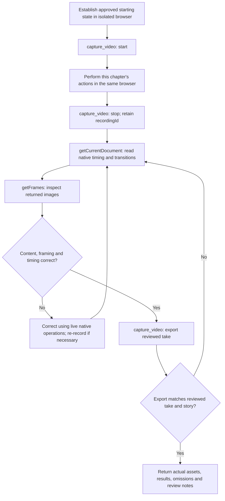

# OpenScreen capture workflow

Adapted from https://github.com/getopenscreen/openscreen/blob/main/plugin/skills/openscreen-demo/SKILL.md (copied 2026-10-20).
License: MIT; see openscreen-demo.LICENSE alongside this file.
Included directly; does not require a separate skill invocation. User timing, story boundaries, presentation and audio directions override defaults.

## 1. Prepare the take

- Establish the planned starting state with consistent, non-sensitive data. Record only the isolated application window; exclude browser chrome, desktop content, notifications, credentials and private information. Kiteva owns browser isolation. OpenScreen owns native cursor recording. Keep desktop interaction within a dedicated recording environment; use the native frame review to verify the actual cursor.

## 2. Record through capture_video

- `reference_browser/capture_video`: `action: "start"` with supported 2D cursor theme/framing -> planned interactions in the same browser -> `action: "stop", recordingId`.
- The capture adapter passes actual browser action positions to OpenScreen's native setPointerTrack after recording stops. Review native frames for cursor visibility and click alignment.
- Stop stops recording without exporting; it returns live descriptions and argument schemas for supported native operations. Retain recordingId. Preserve action order and readable results; captured footage is excluded from the energetic pacing default.
- Native zooms and camera defaults are preserved; never assume zooms were generated or reviewed. Cursor smoothing is disabled (0).

## 3. Read the native document

- All native operations: `action: "edit", recordingId, native: { operation, arguments }`. First operation: `getCurrentDocument`, arguments `{}`. Omit projectId and paths. Use the returned live schemas rather than guessing operation arguments.
- Read source-time versus virtual-ruler seconds and transition windows; never infer native edit times from the export clock. OpenScreen owns camera animation, cursor following and edit-time mapping. Check errors, partial refusals and `cutTransitions`; partial acceptance is not complete success.

## 4. Inspect frames before export

- `getFrames` -> inspect returned images at actions/results, page changes, before/during/after every zoom transition and at both boundaries of speed regions. Review the complete active control, label and result, typed text, pointer arrival/click feedback, callouts, privacy and missing/black frames.
- A document read, cursor-track read or contact sheet alone does not replace this native frame review.

## 5. Correct and review again

- Focus: Use addAutoZooms for native click-based suggestions, or addZooms/setZoom deliberately. If clipped, reduce the scale, adjust focus or remove the zoom, then review again. Use removeModifier to stay wide.
- Timing: preserve the complete recorded sequence. Never add trims, skip actions or cut out waiting/typing. Use native addSpeed/setSpeed with the live schemas to accelerate slow portions into the assigned chapter budget. Keep key clicks, results and playback readable at normal speed. Label accelerated intervals clearly. If the complete sequence cannot fit clearly, report a timing conflict instead of exporting an oversized take.
- Annotations must clear active content. Re-record wrong windows, missed actions or private content when native correction is unsuitable. Use checkpoints for recovery.
- After any edit, inspect the affected frames again, including transitions. Do not proceed to export with known clipping or unresolved required framing checks.

## 6. Export the reviewed take

- `action: "export", recordingId` -> validated silent WebM, 60 fps. Only exported assets enter inventory. Export does not add zooms or refill deliberately wide intervals. Preserve presentation; no extra cursor or zoom layer during assembly.

## 7. Reconcile and hand off

- Verify exported footage against the reviewed take and story beats; export problems loop back to native review/correction. Return actual assets, results, review notes and omissions; describe simulated behaviour as simulated.
- Sidecar times are source-recording timestamps with trim provenance, not edited-video cues; use native document mapping for integration.
- Optional unavailable operations may be omitted. Missing recording, native review, required correction, export or integration -> exact limitation through the blocking flow; never invent success or substitute illustrations. Unsupported application interactions follow the route's separate omission policy. Keep origin/data boundaries. The assigned chapter duration is an export budget, not a model-call timeout. No permission to install or publish.

## Native cursor data

OpenScreen owns cursor rendering, interpolation, themes and click effects. The
capture adapter collects trusted browser mouse events in the windowed browser and
passes their measured positions to native `setPointerTrack` after stopping. Browser
screen coordinates are relative to the recorded window; the adapter converts them
to fractions automatically. Review `getCursorTrack` and native frames before export.
