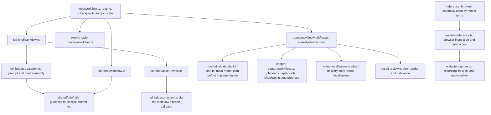
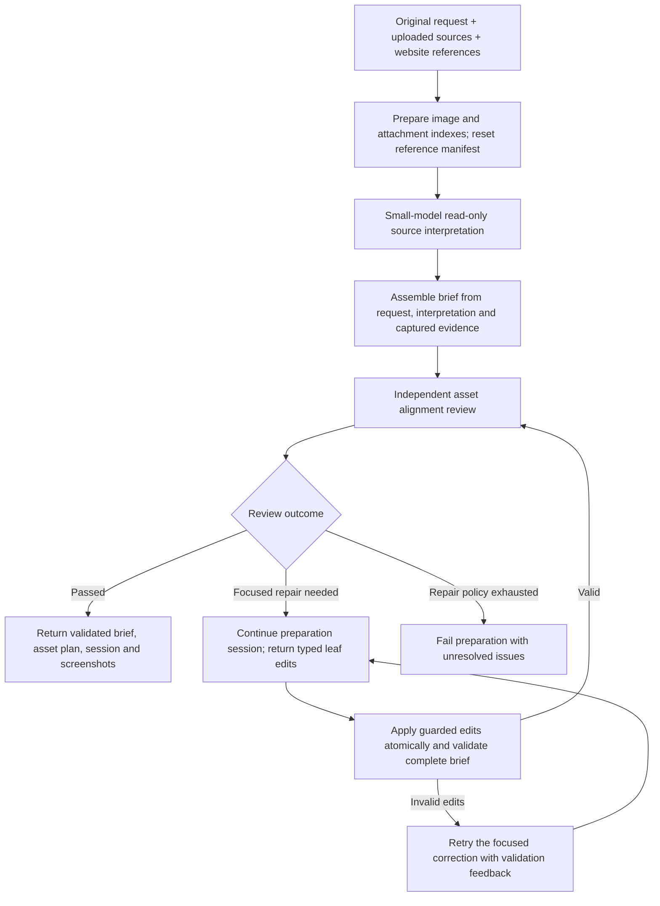
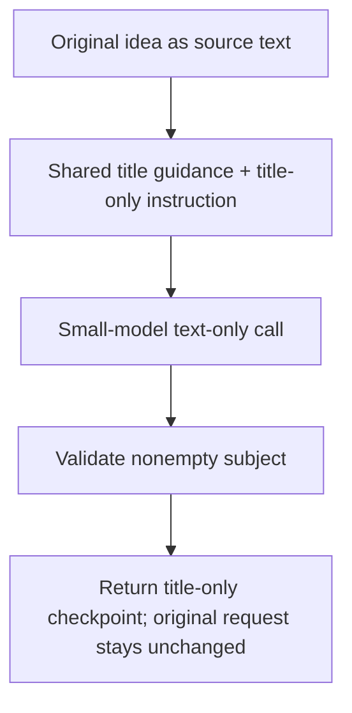
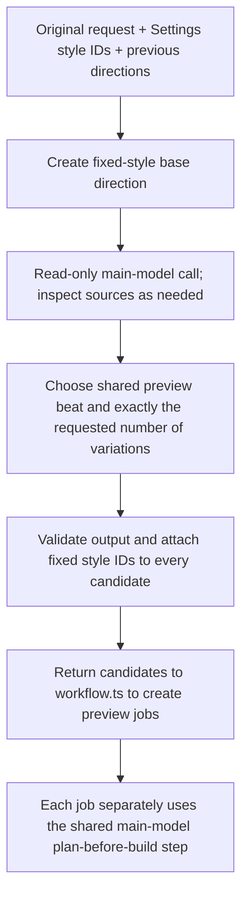
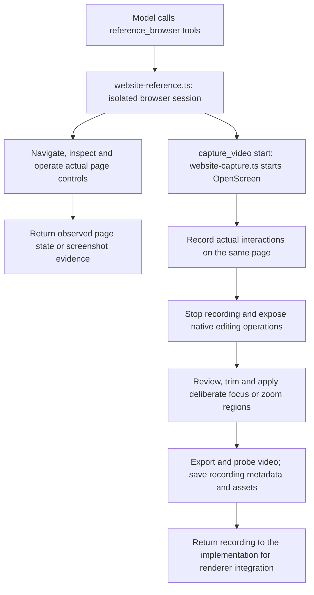
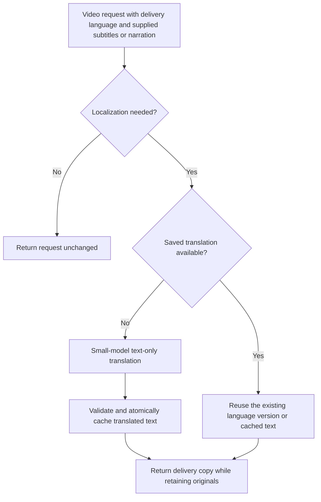
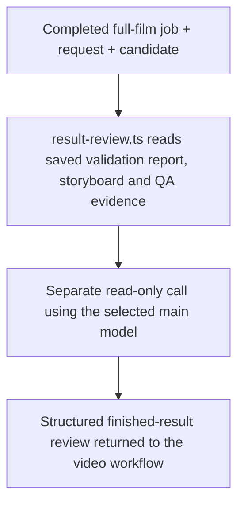
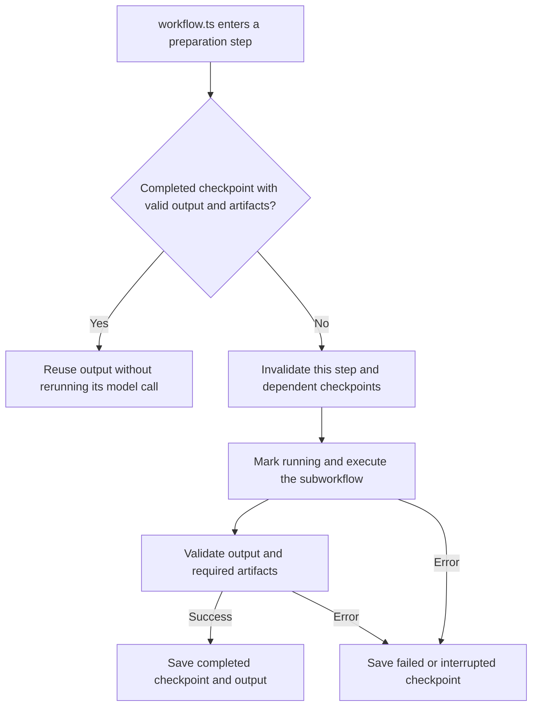
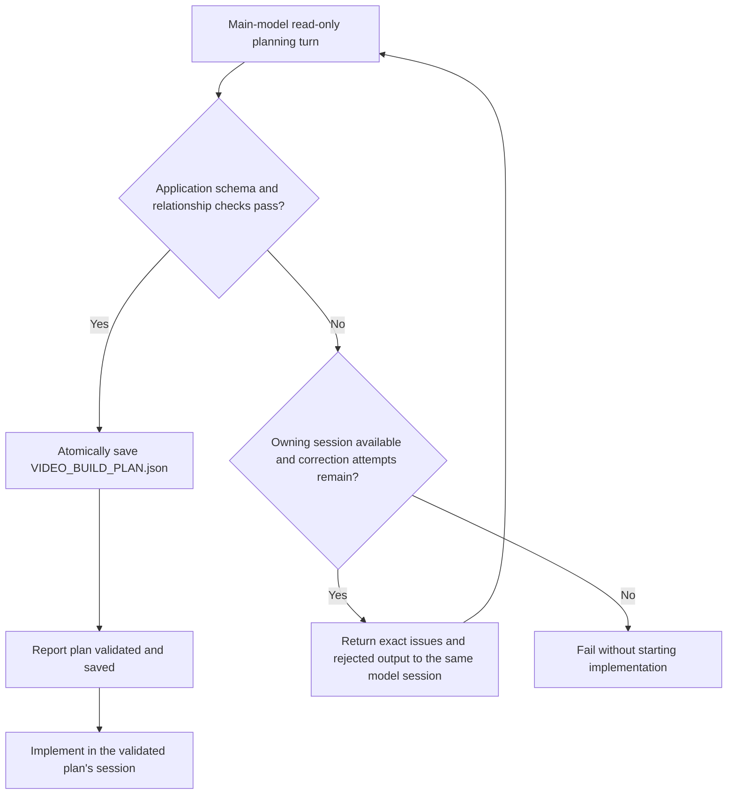

# Job subworkflows

Chapter planning, speed adjustment, duration acceptance and intact assembly follow
[the chapter capture timing flow](../../../../docs/chapter-capture-timing.md).

`../workflow.ts` selects the route and owns checkpoints and job state. Each subworkflow owns its task's execution.

```text
subworkflows/
├── full-brief/
│   ├── workflow.ts       # Source inspection, interpretation, review and correction
│   ├── preparation.ts    # Full brief prompt and handoff assembly
│   ├── asset-review.ts   # Independent source alignment review
│   └── correction.ts     # Apply and validate focused corrections
├── explicit-style-preview/
│   └── workflow.ts       # Main-model preview executions of fixed user styles; no JEV style ranking
├── chapter-capture/
│   ├── workflow.ts       # Sequential chapter model calls, verified export checkpoints and progress
│   ├── prompt.ts         # Explicit context and shared rules for each fresh chapter session
│   └── handoff.ts        # Validated capture results shared with narration and assembly
├── title-brief/
│   └── workflow.ts       # Text-only project title extraction for direct builds
├── shared/
│   └── brief-title-guidance.ts  # Title instruction used by both brief variants
├── website-reference.ts
├── website-capture.ts
├── result-review.ts
└── video-localization.ts
```

Full brief is used for automatic style exploration. Title brief is used with Motion Graphics selected in Settings and returns only `subject`; it does not inspect sources or plan production. With previews enabled, explicit-style-preview uses the main model to plan exactly the requested number of creative executions of those fixed styles, preserving original act/scene assignments. With zero previews, the route builds the full project directly. Neither explicit-style route proposes or ranks style combinations. Audio and visual-authoring capability decisions remain separate.

Both brief variants use the existing `brief` checkpoint. Title-only output carries `variant: "title-only"`; full output carries its asset-review revision, so an incompatible cached result is not reused. The complete original request remains available to the main planner and builder in both routes.

Chapter capture owns its per-call prompt in `chapter-capture/prompt.ts` and the planned chapter loop: one fresh selected-model session per chapter, with explicit scope/story, chapter instructions, source requirements and previous-result context, native export evidence validation, video-and-cursor checksum validation, checkpoint persistence and measured progress. Saving progress preserves unvisited checkpoints for later validation, including across failure or cancellation; it does not count them as completed. Checkpoints without a cursor checksum require one fresh capture before reuse. It runs sequentially before narration and film assembly; chapter session IDs are saved for audit and cannot replace the main planning session. Narration reads the completed capture handoff explicitly, and its cache includes that evidence. Route A guidance is stage-specific: `domains/video/route-prompts/application-demo/planning.ts` owns discovery and scope/story, `capture.ts` owns recording/review rules, and `assembly.ts` owns footage fitting and renderer integration. `shared.ts` owns the continuity, unsupported-interaction, file-picker and footage-placement rules. The placement rule is reused by every assembly route and remains separate from OpenScreen capture framing. Its combined capture rules are injected into every chapter call and retry; they do not depend on earlier session messages. Each stage embeds a Mermaid flowchart for ordering, decisions and review loops, with short rules for required constraints. New planning and assembly calls do not receive the native recording procedure. Shared chapter plan/progress schemas stay in `src/shared/capture-chapters.ts` because the planner, server and activity UI consume them.

Website reference, website capture, result review and localization remain separate subworkflows. MCP tool definitions and server entry points remain in their existing tool modules, outside this folder.

Routing and selection limits use only `request.selectedStyleIds` from Settings. Names, IDs, exclusions and descriptive references inside the original idea remain prose for the model to interpret; no string matcher converts them into selections.

## Subworkflow diagrams

Current implementation: 2026-10-21. The [generation and prompt-route diagrams](../../../../docs/architecture.md#video-generation-routes)
show where these tasks fit in the overall video flow. Arrows below show calls or handoffs, not
filesystem nesting. Browser tools are callable capabilities, not mandatory standalone model stages.

### Ownership and calls



`shared/brief-title-guidance.ts` is prompt text reused by both brief variants; it is not an agent
call. The full-brief folder owns its review and correction modules; title-only preparation does
not run those modules.

### Full brief, asset review and focused correction



`asset-review.ts` can also correct malformed review output before acting on its findings.
`correction.ts` owns validation/retry of leaf edits; it does not replace the whole brief.
Repair loops follow their existing bounded review/correction policies.

### Title-only preparation



This workflow does not browse, inspect attachments, select styles or plan production.

### Explicit-style preview concepts



This extra preparation call currently exists. It does not use JEV, rank styles, build previews or
provide the per-job validated production plan.

### Website inspection and recording



Recording is an implementation capability, unavailable during read-only planning. The screenshot
and recording branches are different artifacts, not interchangeable demo fallbacks.

### Video copy localization



### Finished-result review



This runs for full jobs, not previews; it does not replace build planning or renderer validation.

### Preparation checkpoints and retries



The wrapper lives in `../preparation-checkpoints.ts`. Request fingerprints govern reuse across
preparation runs. A retry can reuse valid earlier checkpoints; it must not claim an interrupted
step completed. The separate job build-plan checkpoint belongs to its model and session.

### Shared video build-plan validation and correction



The shared step allows three total planning attempts. Only structured-output validation failures
enter this correction path; cancellation and unrelated provider failures propagate immediately.
The SDK response retains its session ID even when application validation rejects it. Reading a
model response successfully is not evidence that its plan has been validated or saved.

### Activity ownership

Execution tracing uses `activityScope(label, async () => { ... })`, from `jobs/activity-scope.ts`. Calls inside a scope inherit its ID as their tracing parent. Wrap each retry in a fresh child scope and await work that belongs to the scope. A scope's own lifecycle sets its tracing outcome; successful tool calls alone cannot complete the enclosing operation. These boundaries do not define customer-facing activity groups.

Workflow roots supply the persistence callback and cancellation signal. `activityEventData` preserves the emitting operation's scope; `bindActivityCallback` retains it across SDK and MCP callback boundaries. WorkQueue uses Node's AsyncResource to preserve context when a queued task starts under a different worker. Persistence and event transport do not assign parents or own lifecycle tracking.

Persisted `activity_scope` events carry the tracing ID, parent ID, label and lifecycle state. Leaf events carry `activityScopeId` for correlation. The customer activity model hides execution-scope records and groups actual events by their named work in `client/activity-display.ts`, using the same presentation for old and new records. Preparation checkpoints, chapter progress, timing-correction attempts, narration and rendering retain their event-based groups. Repeated named actions within a group show the latest result and timestamp; execution depth never adds UI nesting. Scope-engine tests cover tracing; activity-display and browser tests cover customer grouping.

Chapter timing retries live in `chapter-capture/timing-retry.ts` (`captureWithTimingRetries`). This module consumes the approved capture plan and retries only `ChapterTimingConflictError` within the per-chapter retry budget; it does not create or revise the full-film plan. `domains/video/build-plan.ts` owns full-film and capture-plan generation, and `chapter-capture/workflow.ts` owns capture execution and validation.
